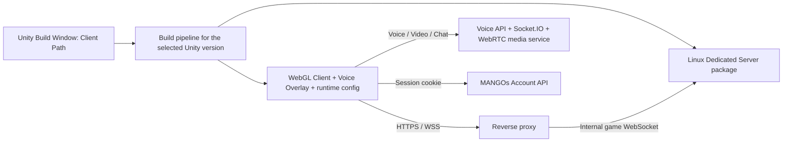

# MANGOs Framework migration plan: Unity 6.3, browser voice, builds, avatars, and mobile

[English](MIGRATION_PLAN_EN.md) | [ภาษาไทย](MIGRATION_PLAN_TH.md) | [All documentation / เอกสารทั้งหมด](README.md)

> This document preserves the plan written before implementation. For delivered behavior and remaining limits, read [Getting started](HANDOFF_EN.md) and [Validation](VALIDATION_EN.md).

Inspection date: 16 October 2026. Historical status at the time of writing: source inspection only; the project had not yet been opened in the new Editor, its runtime changed, or builds attempted.

## 1. Goals and scope

1. Assess and attempt migration from Unity `2022.3.62f3` to `6000.3.26f1`, as requested. If FishNet, glTFast, shaders, or IL2CPP cannot work with the target, investigate alternatives first. If none works, skip the upgrade, retain the original Unity version, and continue tasks 2–5 under section 4.3.
2. Remove the old Unity voice communication system and use `html-voice-tester-main` in the WebGL page.
3. Provide a Unity menu for ordinary builds by changing only `Client Path`, then building Linux Dedicated Server, WebGL Client, or both. Expose independent Server/Client Port and WSS controls: Server defaults to `7770`, WSS unchecked; Client to `443`, WSS checked. Select platforms and package the overlay automatically.
4. Use each avatar model's own skeleton and Humanoid mapping, and inspect `.anim` clips and network animation.
5. Detect desktop, phone, or tablet and portrait/landscape automatically, selecting suitable controls/layouts and adapting during play. Cover movement, camera, interactions, and the existing flying mode.

This is an implementation proposal and acceptance plan, not a report of completed work. Existing README/documents provide context; they do not change the user's requested scope.

## 2. Findings from source inspection

The open workspace is `C:/CosmoPC/Work/Unity/html-voice-tester-main`; the Unity project is its sibling `C:/CosmoPC/Work/Unity/MANGOsFramework_U6`.

| Area | Evidence from local files at planning time | Implication |
|---|---|---|
| Unity | `ProjectSettings/ProjectVersion.txt`: `2022.3.62f3` | A real migration is needed despite U6 in the branch name. |
| Git | `.git/HEAD`: `MANGOsFramework_U6`; remote config points to `AlbiziaLebbeck/MANGOFramwork.git`; local ref `e461cdcad0b5bf7191f903afc828ea248b296a6f` | Preserve pending edits before starting. This does not establish that local matches the latest remote. |
| New Editor | `6000.3.26f1`, `WebGLSupport`, and Linux server Mono/IL2CPP variations are installed | Compiler/toolchain readiness still needs real builds. |
| Packages | URP `14.0.12`, Cinemachine `2.10.4`, Input System `1.14.0`, TMP `3.0.9` | Move to compatible 6.3 versions and pin the tested set. |
| glTF loader | `com.atteneder.gltfast` is an untagged Git URL; lock records `ef121f3a88707d79c178f4d573620566b1ced6b9` | Pin the dependency and verify shaders/runtime APIs. |
| Build | `Assets/_Project/Scripts/Editor/BuildsScript.cs` already provides Client/Server menus | Extend the existing tools with packaging and result validation. |
| Scenes | Old script enumerates all `.unity` files in a folder; settings list Bootstrap → Launcher → BaseWorld and disabled TestScee | Use a deliberate ordered list and validate scene availability. |
| Network | FishNet + Multipass + Bayou + Tugboat; prefab uses localhost, 7770, WSS off | WebSocket/UDP game networking is separate from voice. |
| Client Path | Bayou separates `_clientAddress`, `_port`, `_useWss`, `_clientPath`; ClientSocket uses `UriBuilder.Path` | This field means a WebSocket URL path such as `/mangos/demo`, not an output directory. |
| Old voice | C# manager self-initializes before the first scene; `.jslib`, JS, and Socket.IO live in the WebGL template; `ChatCanvas` references the manager | Removing a scene GameObject alone is insufficient. Remove bootstrap and references. |
| New voice | Overlay includes voice, chat, video, screen sharing, speaking status, and cookie auth; default room is `MEA-voice` | Add lifecycle handling and bind rooms to the game. |
| New WebGL HTML | `index.html` hard-codes `metartc.*` names and references TemplateData/manifest files absent from the supplied set | Use Unity template variables and include required files; do not overwrite build HTML blindly. |
| Hosting example | Existing nginx serves HTTP and prefers `viewer.html` over `index.html` | Set the correct entry point and config for actual Unity output. |
| Avatar | `AvatarLoader.SetupAnimator()` selects Resources Avatar assets from object/bone paths and falls back to `ArmatureAvatar` | Mapping/rest pose can mismatch the imported model. |
| Animator | Walking/flying NetworkPlayer prefabs reference the old Animator; movement/seat scripts use `GetComponent<Animator>()`; FishNet NetworkAnimator holds the same component | Moving the Animator requires updating every consumer. |
| Animation | `walk_fwd.anim` contains Humanoid muscle curves such as `Spine Front-Back`, plus Root/Foot curves; walking/flying controllers have different parameters | Retargeting is plausible, but audit all clips, including embedded FBX clips. |
| Mobile | `UIJoystick`, `UITouchPanner`, `LocomotionCanvas`, Touch Action Map, Safe Area, and Orientation UI exist | Improve and connect existing components. |
| Flying | `BasicBehaviour`, `FlyBehaviour`, `MoveBehaviour`, and camera use `Input.GetAxis/GetButton` | Existing joystick does not cover this path; provide a shared input adapter. |

This was static local inspection. It did not fetch Git, establish a clean working tree, contact production APIs, test login/microphones, or run the Server.

## 3. Proposed architecture



Unity Server owns worlds, players, and game state. The browser overlay owns microphones/media and uses the replacement system's WebRTC channel; voice is not carried over FishNet. Packaging the overlay into Client does not create a voice backend or TURN server.

## 4. Task 1 — Upgrade Unity to 6000.3.26f1

### 4.1 Baseline and rollback

- Inspect Git diffs/untracked files, preserve pending work, and create a migration checkpoint/branch before opening the new Editor.
- Preserve `Assets`, `.meta`, `Packages`, `ProjectSettings`, build/deploy config, and a working old build. Keep Editor 2022 for comparison.
- Record visuals/behavior for login, entering a world, two players, avatar changes, walking/flying, sitting, interactions, and server connection.
- Record FishNet/Bayou versions and vendor modifications, especially `_clientPath`, so package updates cannot silently erase them.
- Inventory embedded dependencies, DLLs, shaders, renderer features, and actual AssetBundle/Addressables usage. Plan to rebuild old bundles for the selected Editor if needed.

### 4.2 Editor migration and compatibility work

1. Open a migration copy/checkout with `6000.3.26f1`. Read the 2022 → 6.0 → 6.1 → 6.2 → 6.3 changes even when trying a direct upgrade.
2. Resolve compatible packages and pin manifest/lock. Do not upgrade every package to latest at once.
3. Move URP 14 to a target-compatible series. Check Renderer Assets, Volumes, Shader Graph, lighting, shadows, transparency, and runtime avatar shaders.
4. Target Render Graph. The 6.3 guide describes removal of the normal Compatibility Mode path and a temporary migration define. For complex old render passes, consider 6.0–6.2 as an intermediate step only where needed; do not require every intermediate Editor in advance. See the [Unity 6.3 upgrade guide](https://docs.unity3d.com/6000.3/Documentation/Manual/UpgradeGuideUnity63.html).
5. Check Cinemachine 2.x before retaining/replacing it. Migrating to Cinemachine 3 needs a reason and separate work because existing code uses `CinemachineVirtualCamera`/`CinemachineFramingTransposer`.
6. Fix Input System/uGUI/TMP and changed APIs, `.jslib`, Emscripten interop, FishNet code generation, stripping, and IL2CPP/AOT.
7. Prove the Linux cross compiler and WebGL toolchain with real builds, not installed module folders alone.
8. Complete small Server/Client builds before redesigning the entire avatar pipeline.

Acceptance: no Editor compile errors or migration-created missing scripts, intact visuals, a running Linux Server, and two WebGL Clients in the same world observing movement.

### 4.3 Alternatives and the upgrade-skip condition

The user explicitly requires that the Unity upgrade must not block tasks 2–5 indefinitely. If FishNet, glTFast, shaders, or IL2CPP cannot work on `6000.3.26f1`:

1. Isolate the failure and retain reproducible compile/build logs, runtime errors, or incorrect shader visuals, identifying dependency/version and affected target. Do not declare incompatibility before checking the cause.
2. Investigate and test suitable alternatives, considering their effects on the existing system and other tasks.

| Incompatible area | Alternatives to evaluate before skipping |
|---|---|
| FishNet/Bayou | Compatible versions/patches preserving Client Path changes; verify code generation/transport and real multiplayer. For a different transport/network stack, assess migration scope and replacement capabilities first. |
| glTFast | A compatible pinned version or another importer supporting the needed GLB/VRM and runtime WebGL paths; test materials, animation, and memory release. |
| shaders/URP | Adapt shaders, Shader Graph, or render passes to the target pipeline, or choose suitable replacement shaders/materials; compare avatar/scene visuals. |
| IL2CPP/AOT | Fix the actual toolchain, package/native plugin, AOT, or stripping cause; test Linux and WebGL. Changing the Server backend alone does not resolve WebGL limitations. |

3. Adopt an alternative only after it passes Server/WebGL acceptance and preserves required capabilities. Record changes and effects in the migration report.
4. If no workable approach is found, mark the upgrade **Skipped — compatibility unresolved**. Record causes, attempted solutions, and conditions for revisiting; do not report a successful upgrade.
5. Return to the preserved Unity `2022.3.62f3` baseline, retaining the user's work and separating migration experiments. Do not directly reopen Unity-6-converted Assets/ProjectSettings in 2022.
6. Continue **task 2 voice, task 3 builds, task 4 avatars, and task 5 mobile controls** on the original Unity version in section 9's order. Adapt dependencies/APIs and tests to that Editor rather than waiting for Unity 6 compatibility.

For the skipped-upgrade route, use Unity-2022-compatible `EditorWindow` + `BuildPipeline` instead of Unity-6-only Build Profiles APIs, and test runtime importers, browser support, and mobile performance on 2022 itself. Accept tasks 2–5 separately from the upgrade status and report the delivered Editor version clearly.

## 5. Task 2 — Remove old voice and integrate html-voice-tester-main

### 5.1 Remove every old integration path

- Trace references to `Assets/_Modules/VoiceCommunication`, `Assets/Plugins/WebGL/VoiceCommunication.jslib`, `Assets/WebGLTemplates/MANGOsPWA/VoiceCommunication`, and related typed config/assets.
- Remove RuntimeInitialize bootstrap, native JS imports, template scripts, UI listeners, and old microphone callbacks.
- Adapt `ChatCanvas`, microphone/video icons, network mic state, and Prefab/Scene UnityEvents to the new UI without leaving broken references.
- Retain game sounds such as footsteps, music, and object audio. The scope is voice communication, not all AudioSources/AudioListeners.
- Make the overlay the main WebGL communication UI. Check overlap with existing text chat before moving it: game chat may support interactions or other channels. Retain needed paths until replacement is tested.

### 5.2 Repeatable WebGL-template integration

1. Store `voice-app.js` and `voice-overlay/` inside the Unity project or a pinned dependency; do not rely on a developer's absolute path.
2. Integrate UI/authentication using the current template as a base. Replace hard-coded loader/data/framework/wasm names and compression with Unity template variables.
3. Load the overlay once, after public runtime config. Check ES-module MIME types and relative URLs under a subdirectory.
4. Add overlay lifecycle APIs such as `initialize`, `setSession`, `setRoom`, `leave`, and `dispose`. These names were proposed APIs, not a claim that all existed at planning time.
5. Add a thin C#/JS bridge for room/player status; keep microphone logic in the browser.
6. Emit Unity events after successful spawn, world changes, disconnect, and logout. Return browser mute/speaking state only where the game needs overhead indicators.

### 5.3 Rooms, identity, and devices

- Use a Server-confirmed world/session identifier as the room key, with deployment namespace as needed. Do not put every deployment in `MEA-voice` or automatically substitute Client Path for world id.
- Before spawning or switching rooms, leave the old room, stop tracks/subscriptions, then bind the next room in order. Prevent duplicate overlay instances from opening the microphone twice.
- Existing `getVoiceConfig()` reads startup config and the speaking sender retains its room. Update Voice/Chat/Video/Speaking lifecycle, not just a global `roomId`.
- Preserve cookie auth (`credentials: include`) and test CORS, SameSite, cookie domains, and Safari restrictions. Cross-site hosting needs a backend-supported flow; do not put secret tokens in build config.
- Map account user id to network player/session explicitly. Unity's uint UID and overlay participant id differ, and one account may have several tabs. Display names are not identities.
- Make auth polling detect logout/account changes; the inspected poller stopped after finding a user.
- Start capture/playback from a permitted click/touch. Handle permission denial, no microphone, disconnect, and return from background.
- The new code already calls `/api/v1/ice-servers` with a STUN fallback. Verify usable TURN on restricted/mobile networks; STUN fallback is not universal connectivity.
- Enable screen sharing according to browser capability. Unsupported devices need suitable UI while voice/movement remain available.
- Handle partial failure, such as room join succeeding but microphone access failing, with room/socket/track cleanup and retry without stale participants.

Acceptance: one active voice system, isolated A/B rooms, two real accounts talking, correct mute/leave/login/logout, no stale room after world changes, reconnect recovery, and playable game behavior during voice-service failure.

## 6. Task 3 — Build menu with defaults and editable Port/WSS

### 6.1 User-facing window

Proposed menu: `MANGOs Framework > Build Center`.

```text
Client Path: [/mangos/demo]

Server Settings
  Port: [7770]     WSS: [ ]

Client Settings
  Port: [443]      WSS: [x]

[Build Server]  [Build Client]  [Build Both]

Profile: Production       (configured by the team)
Server: Linux Dedicated   Client: WebGL
Output: Builds/<deployment>/<build-id>/

[Save Profile]  [Reset Network Defaults]
```

Both Port fields and WSS checkboxes must be directly editable without Inspector/source edits. Apply defaults only when creating a profile or explicitly resetting network defaults. Persist independent overrides per profile; Build must not silently overwrite them. Ordinary builds must still need only Client Path changes.

Based on Bayou's `_clientPath`, this field accepts a URL path such as `/mangos/demo`. If full domain editing is later needed through a full WSS URL, add a separate validated mode rather than guessing host/path from strings.

One path cannot configure a previously unknown hostname, TLS certificate, and deployment location. Prepare the Deployment Profile and proxy mapping once; ordinary builds can then change just Client Path, with Port/WSS in the same window when needed.

### 6.2 Network policy

| Side | Default port | Default WSS | Meaning |
|---|---|---|---|
| Server | `7770` | Unchecked | Bayou listener and Server TLS, independent of Client. |
| Client | `443` | Checked | Destination port and WebGL connection scheme, independent of Server. |

The normal topology is `wss://<configured-host>:443/<client-path>` through a TLS-terminating reverse proxy, forwarding WS to Server `7770`. Different Port/WSS values on each side are intentional. Local development can save WS and another port in a separate profile using the same fields.

Apply each UI value to the right side. Bayou `_useWss` controls Client connections; Server WSS must control Server SSL configuration. When Server WSS is enabled, provide/validate Server certificate config without shipping private keys/passwords to WebGL. Keep Tugboat UDP configuration separate from Bayou TCP where native/Editor clients use it.

Validate ports in `1–65535` and scheme/hosting/TLS consistency, including WS from HTTPS pages and Server WSS without certificate config. Explain corrective action before building without silently changing the user's choices.

Generate proxy examples from Client Path and chosen Port/WSS, including WebSocket Upgrade, timeouts, upstream scheme, Bayou-compatible rewrites, WebGL headers/MIME/compression. Build must not implicitly deploy or edit the live proxy.

### 6.3 Pipeline sequence

Support the Editor selected under section 4.3. Unity Build Profiles may be used after a successful upgrade; the Unity 2022 route uses tool-owned config with `BuildPipeline`, while keeping the same window/buttons.

1. Validate Editor version, modules, scenes, writable output, path, independent Port/WSS, TLS, overlay assets, and profile.
2. Use enabled `EditorBuildSettings` or the profile's explicit scene list: Bootstrap → Launcher → BaseWorld and required worlds. Do not collect test scenes by scanning a folder.
3. Generate public Client runtime config and Server config from the same profile, applying each side's settings plus build id/protocol version. Include overrides in the manifest and proxy example.
4. Server: select `StandaloneLinux64` + Dedicated Server subtarget and output `MANGOsServer.x86_64`; verify IL2CPP with the tested toolchain.
5. Client: select WebGL and the integrated template. Choose a desktop/mobile-tested texture/compression policy, not an unconditionally ASTC-only carryover.
6. Make Build Both resumable across platform switches/compilation/domain reload. Persist job state or use separate batch processes; static variables and try/finally alone are insufficient.
7. Do not modify original Prefabs/Scenes to switch WSS/ports. Use runtime config or build processing on scene copies, ensuring config precedes NetworkManager startup.
8. Read each target's `BuildReport`. If one fails, report an incomplete pair and preserve the last successful release. Finalize from staging only when complete.
9. Restore temporary Editor/profile settings on success, cancellation, or error, retaining per-target logs.
10. Inspect output contents, write the manifest, and show an openable output path.

Ship the whole Server package: `.x86_64`, `_Data`, libraries, and Unity runtime files. Include Linux permissions/launch handling rather than copying the executable alone.

```text
Builds/<deployment>/<build-id>/
  Server/   MANGOsServer.x86_64 + data/libraries/config
  Client/   index.html + Build/ + TemplateData/ + StreamingAssets/
            voice-app.js + voice-overlay/ + public-runtime-config.json
  Deploy/   proxy example + start script + deployment notes
  build-manifest.json
  Logs/
```

Acceptance: Build Both works from either starting platform; new profiles use Server `7770`/WSS unchecked and Client `443`/WSS checked; independent edits survive save/reopen/build without Inspector changes or cross-overwrites; reset restores defaults; no hard-coded `metartc` output name; complete repeatable output; and the matching Server/Client actually connect through the configured path/TLS topology.

## 7. Task 4 — Avatars, .anim, and skeletons

### 7.1 Existing flow and likely causes

Account supplies URL → FishNet SyncVar distributes it → `AvatarLoader` loads with glTFast → chooses a Unity Avatar asset from hierarchy names → adds Animator → applies existing Controller → rebinds.

A Unity Avatar stores Humanoid mapping/rest-pose information, not the visible mesh. `.anim` stores motion; Animator Controller selects states/blending from parameters. Sharing a Controller is reasonable, but mapping must match the actual model.

Different models reusing prebuilt Resources Avatars and one fallback is a likely risk. Similar bone names do not prove matching lengths, local axes, parent transforms, or T-pose. Wrong mapping/rest pose could explain stretching/shrinking, but failing models must still be checked to distinguish invalid skin weights, bind matrices, scale, or source animation curves.

### 7.2 Proposed structure

```text
NetworkPlayerRoot
  NetworkObject / movement / CharacterController / camera anchors
  AvatarVisualRoot
    Imported model
      Its own mesh + skeleton
      Animator + Unity Avatar built/imported for this skeleton
```

Share movement and animation state/parameters while retaining each model's skeleton, skin weights, and inverse bind matrices. Do not stretch limbs onto a prebuilt skeleton.

Provide one active-Animator reference service, such as `AvatarRuntimeContext`/`PlayerAnimationDriver`. Update movement, NetworkAnimator, flying, seats, special moves, event receivers, and animator reset to use it instead of finding a replaced root Animator.

### 7.3 Supported-model boundaries

| Avatar type | Proposed route | Scope after validation |
|---|---|---|
| VRM 1.0 | UniVRM runtime importer and file Humanoid metadata | Primary option for characters using their own bones. |
| VRM 0.x | A supported load/conversion route to VRM 1.0 | Verify materials, forward direction, expressions, and spring bones. |
| Mapped Humanoid GLB | glTFast/chosen importer plus a per-model Unity Avatar | Support when hierarchy/rest pose/skin passes validation. |
| Unmapped Humanoid GLB | Profiles/aliases, with confirmation or upload preprocessing | Do not infer success from bone names alone. |
| Non-Humanoid or unrigged GLB | Its own Generic animation, a dedicated adapter, or fallback | Automatic reuse of all human animations is not possible. |

UniVRM documents runtime import, VRM 0.x/1.0, IL2CPP, and WebGL, making it a candidate to prototype with `6000.3.26f1` and the target URP before selecting a tag. See [UniVRM](https://github.com/vrm-c/UniVRM).

For GLB without Humanoid metadata, build `HumanDescription` from that model's transforms/rest pose and call `AvatarBuilder.BuildHumanAvatar`, checking `isValid`/`isHuman`. The API does not automatically discover correct mappings for every GLB. See [Unity API](https://docs.unity3d.com/6000.3/Documentation/ScriptReference/AvatarBuilder.BuildHumanAvatar.html).

### 7.4 Implementation sequence

1. Create a diagnostic scene/report for each model: format/version, skeleton tree, required bones, duplicates, scale, pose, skinned meshes, bone references, height, and material errors.
2. Audit `.anim` and embedded FBX clips used by walking/flying/interaction controllers: Humanoid/Generic, masks, root motion, position/scale curves, IK, and events. Generic clips cannot become Humanoid by flipping a flag; reimport/retarget from source or convert correctly.
3. Prototype with one existing model, one known failing model, and a VRM with different proportions. Confirm the model's own Animator/Avatar before replacing the whole loader.
4. Route imports by content/metadata, not URL suffix alone; URLs may contain queries or lack `.vrm` endings.
5. Validate mapping/rest pose without guessing bind-pose changes. A/T-pose normalization must preserve consistency with the skinned mesh.
6. Set human limits and arm/leg stretch carefully. Reduce IK stretching and check foot sliding/reach; do not hide bad mapping with IK.
7. Derive CharacterController, ground probe, camera target, nameplate, and seat offsets from avatar metrics/profiles. Normalize height with uniform VisualRoot scale if needed, avoiding per-bone non-uniform scale. Align Server-accepted collider ranges with gameplay collision.
8. Distribute avatar descriptor/id, content version, and animation state from Server; load models on Client. Do not stream every bone transform where shared Humanoid state suffices, or require Server to download/render avatars.
9. Verify FishNet NetworkAnimator runtime Animator replacement. If unsuitable, synchronize parameters/state through an animation driver, including late join and model changes mid-state.
10. Keep walking/flying parameter schemas distinct and adapt them deliberately rather than forcing one Controller onto every mode.
11. Handle async races/cancellation during rapid avatar changes. Only the latest request becomes active; retain the old model until ready and dispose retired importer/material/texture resources according to ownership.
12. Replace a fixed 100-model cache with a mobile-appropriate memory budget/eviction policy, separating mapping caches from live Animators.
13. Explain invalid files/incomplete mappings and use a safe fallback, avoiding retry/rebind loops that cannot repair source assets.

Acceptance: supported test models use their own bones without distortion during idle, walk, run, jump, crouch, sit, fly, and relevant emotes; local/remote/late-join state agrees; repeated replacement does not grow memory indefinitely; unsupported models fall back with a reason.

On “any avatar”: support can broaden substantially for correctly rigged/skinned Humanoids, especially VRM, but cannot cover every GLB/VRM file. Retargeting/body metrics address different heights; missing rigs or broken skinning require asset preparation.

## 8. Task 5 — Automatic device/orientation control selection

### 8.1 Improve existing components

- Connect `UIJoystick`/`UITouchPanner` to shared input state with separate pointer ownership, allowing movement, camera, and buttons simultaneously.
- Replace Action Map-name use of `FindAction(mapString)` with correct Action Map management. Check enable/disable event lifecycle across Scene/UI changes.
- Correct joystick radius/sprint and screen-to-Canvas conversion across resolutions.
- Inspect camera logic that compares only the current delta magnitude to its previous value; equal consecutive deltas must not be skipped.
- Replace `Input.mousePosition`-only UI raycasts with the correct touch/pointer. A tap on voice UI must not become movement.
- Detect devices using touch/pointer capabilities as well as UA, with overrides for desktop-UA iPad and keyboard-connected tablets.
- Refresh Safe Area beyond Awake: resize, rotation, and browser toolbar changes. DOM overlay and Unity need consistent safe bounds.

### 8.2 Proposed controls

| Area/button | Walking | Flying |
|---|---|---|
| Left joystick | Walk/run | Horizontal movement |
| Right-side drag | Rotate camera | Rotate camera |
| Jump / Action | Jump/use/sit | Appropriate action |
| Fly toggle + Up/Down | Show if flight is permitted | Ascend/descend/land |
| Voice tray | Join/mute/chat | Same |
| Pinch/zoom | Only where space/gestures allow | According to camera |

Feed Starter Assets and flying through the same `Move/Look/Jump/Sprint/Fly/VerticalMove/Interact` adapter contract. Keyboard/mouse and touch should supply input state rather than simulate keyboard events from onscreen buttons.

Typing chat, opening modals, or invoking browser permissions must suspend relevant input and clear accumulated state. Release outside a button, pointer cancel, blur, backgrounding, or disconnect must stop walking/flying immediately. DOM overlay and Unity Canvas must agree on pointer ownership so opening chat cannot leave movement active.

Unity 6.3 lists supported mobile browsers, but world/avatar/WebRTC performance still requires physical-device tests. See [browser compatibility](https://docs.unity.com/en-us/engine/6000.3/manual/platform-specific/webgl/intro/browsercompatibility).

### 8.3 Device and orientation detection during play

Maintain shared `DeviceFamily` (Desktop/Phone/Tablet/Unknown), `Orientation` (Portrait/Landscape), current input, and current controller/layout state. Supply the same state to Unity UI, movement/camera, and DOM voice overlay.

- Evaluate at page load, before showing controls, and after viewport/orientation/input-device changes. Combine browser/platform, touch/pointer capability, and play-area size; do not use UA regex or width alone.
- Define and record diagnostics for phone/tablet and desktop-UA iPad heuristics. Fall back to input capability when classification is uncertain; browser information cannot reliably identify every device.
- Keep keyboard/mouse usable on touchscreen PCs. Connected tablet keyboards/mice should select appropriate current input while retaining the user's desired touch option.
- Detect play-area portrait/landscape and rotation/resize during play, distinguishing real rotation from soft-keyboard viewport shrinkage.
- Default to `Auto`, allow device/input override, remember it, and offer return to Auto without asking every player before play.

### 8.4 Controller and layout selection

| Device/orientation | Default in Auto | UI layout |
|---|---|---|
| Desktop, either orientation | Keyboard/mouse for current walk/fly mode | Responsive desktop UI, no unnecessary touch controls. |
| Phone portrait | Portrait touch controls | Reachable joystick/buttons, camera drag space, compact chat/voice tray. |
| Phone landscape | Landscape touch controls | Left joystick, right camera area, mode-specific action/flight buttons, safe areas. |
| Tablet portrait | Tablet portrait touch controls | Sizes/spacing suited to larger screens, not only scaled phone UI. |
| Tablet landscape | Tablet landscape touch controls | Two-handed playfield/buttons/overlay spacing, with connected keyboard/mouse support. |

Switch controls/layout automatically on rotation while preserving character, walk/fly state, camera, and room connection. Clear held pointers/input before enabling the new layout, and update safe area, canvas, buttons, and voice/chat overlay together. Rotation must not respawn, reconnect, or request microphone permission again.

Adapt `OrientationManager` and old UI guards to allow both orientations. Do not force rotation where the selected controller should already support play.

Acceptance: automatic desktop keyboard/mouse; correct touch layout at startup and after rotation on Android/iPhone/tablet/iPad; simultaneous movement/look/actions; no safe-area/voice-tray overlap; no stuck input after app switches/rotation; soft keyboard does not misclassify devices; chat does not move the player; complete flying controls; usable connected keyboards/mice and touchscreen PCs; working override/return to Auto.

## 9. Delivery sequence and estimates

| Phase | Work | Gate before proceeding | Estimated workdays |
|---|---|---|---|
| A | Baseline, Git checkpoint, dependency/deployment inventory | Recoverable state and comparison checklist | 1 |
| B | Compatibility → migration or alternatives | Working upgrade with Server/WebGL connection, or documented Skipped route on Unity 2022 under section 4.3 | 2–4 |
| C | Deployment Profile, Build Center, packaging | Both targets build from menus with config and independent Port/WSS fields | 2–4 |
| D | Voice replacement, room/auth bridge | Voice rooms match game rooms | 2–4 |
| E | Avatar diagnostics, prototype, per-model rig pipeline | Accepted model/animation set passes | 5–8 |
| F | Device/orientation controls, walking/flying input, overlay interaction | Correct PC/phone/tablet layouts, including rotation, on real devices | 3–5 |
| G | Integration, regression, deployment rehearsal, docs | Release candidate with acceptance evidence | 2–4 |

Total: about 17–30 workdays for one developer with access to models/backend/staging, roughly 3–6 weeks. This source-based estimate is not a fixed delivery date. Broken source rigs or backend changes may add work.

Phase B is the compatibility decision point. If no upgrade route works, skip it and continue tasks 2–5 instead of blocking other work indefinitely. Reassess estimates for alternatives and the Editor actually used.

The avatar prototype gate precedes full loader replacement. If it fails, decide upload preprocessing/supported formats and revise the plan before implementing the entire pipeline.

## 10. Integration testing and completion criteria

| Area | Important cases | Evidence |
|---|---|---|
| Upgrade decision | FishNet/glTFast/shaders/IL2CPP on 6000.3.26f1 and attempted alternatives; baseline fallback and continued tasks 2–5 if needed | Compatibility results, Upgraded/Skipped status, reason, delivered Editor version |
| Build | Server/Client/Both; default 7770/WSS off and 443/WSS on; independent override/save/reset; either starting target; invalid path/port/TLS; compile failure; cancel; repeat builds | BuildReport, logs, manifests/config, restored Editor settings |
| Server | Actual Linux headless launch, missing config, graceful restart, disconnect/reconnect | Startup/network logs and two Clients |
| Deploy | HTTPS/WSS, proxy paths, wasm/data/js MIME/encoding, nested URLs, cache updates | Requests and successful handshake |
| Voice | Two accounts/multiple tabs, A/B worlds, denied mic, mute, logout, network changes | Roster, media state, actual audio tests |
| Avatar | Short/tall, supported extreme proportions, VRM 0/1, mapped/unmapped GLB, load failure | Diagnostics and motion-test video |
| Multiplayer | Avatar changes, remote animation, late join, disconnect/rejoin | Consistent state across Clients |
| Device/controller | PC/phone/tablet, both orientations at startup/rotation, desktop-UA iPad, touchscreen PC, connected tablet keyboard/mouse, Auto/overrides, move+look+action, flying vertical input, chat keyboard, safe area/background | Physical PC/Android/iPhone/iPad/tablet, recorded detection/controller/layout |
| Performance | World/avatar/voice together, repeated avatar changes, long sessions | FPS/frame time, memory, load time, WebRTC stats |

Measure baseline performance and select player-count/device targets before defining numerical acceptance, such as 30 FPS on agreed minimum hardware. Adding a joystick does not guarantee 60 FPS on every phone.

Useful automated checks include path/config validation, scene order, manifests/overlay packaging, room lifecycle, and cancelling obsolete avatar loads. Microphones, retargeting poses, and multi-touch also need runtime/visual and real-device inspection.

## 11. Information to confirm during implementation

Planning can proceed using these assumptions, but production acceptance requires:

- Real domains/Client Paths, current reverse proxy, rewrites, backend ports, and multiple-deployment/server-instance policy.
- Linux deployment/startup method and backend room-membership/authentication policy.
- At least 2–3 known problematic avatars plus a working comparison, identifying affected poses/controllers.
- Which chat/camera/screen-share UI moves from Unity, and whether overhead indicators/spatial voice are required. Inspected overlay code did not establish 3D positional audio support.
- Minimum phone/tablet list, players per room, and memory/FPS budget.

Baseline/migration work in a copy need not wait for every answer. Production-connected build acceptance needs deployment information; a claim that deformation is fixed needs the failing models.

## 12. Main references

Unity files inspected under `C:/CosmoPC/Work/Unity/MANGOsFramework_U6/`:

- `ProjectSettings/ProjectVersion.txt`, `Packages/manifest.json`, `Packages/packages-lock.json`
- `Assets/_Project/Scripts/Editor/BuildsScript.cs`, `ProjectSettings/EditorBuildSettings.asset`
- `Assets/_Modules/Networking/Scripts/Utils/TransportSetter.cs`, `ConnectionStarter.cs`
- `Assets/Plugins/Networking/FishNet/Plugins/Bayou/Bayou.cs`, `Core/ClientSocket.cs`
- `Assets/_Modules/VoiceCommunication/VoiceCommunicationManager.cs`, `VoiceCommunicationConfig.cs`
- `Assets/_Project/Scripts/Runtime/UI/Canvases/ChatCanvas.cs`
- `Assets/Plugins/WebGL/VoiceCommunication.jslib`, `Assets/WebGLTemplates/MANGOsPWA/index.html`
- `Assets/_Modules/AvatarSystem/Scripts/AvatarLoader.cs`, `Assets/_Modules/AvatarSystem/AvatarSystem.cs`
- `Assets/_Modules/Networking/Scripts/Clients/NetworkedPlayerComponent.cs`
- `Assets/_Modules/Networking/Prefabs/NetworkPlayer.prefab`, `NetworkPlayer_Flyable.prefab`
- `Assets/_Modules/PlayerController/Scripts/Runtime/PlayerMovementHandler.cs`, `UIJoystick.cs`, `UITouchPanner.cs`
- `Assets/_Modules/PlayerController/Animations/CustomThirdPersonController.controller`
- `Assets/3rdPerson+Fly/Animators/CharacterController.controller`, `Animations/Locomotion/walk_fwd.anim`
- `Assets/_Project/Scripts/Runtime/Utils/CheckMobile.cs`, `Assets/Plugins/WebGL/CheckPlatformPlugin.jslib`

Overlay files inspected under `C:/CosmoPC/Work/Unity/html-voice-tester-main/`: `index.html`, `voice-app.js`, `voice-overlay/config.js`, `app.js`, `auth.js`, `identity.js`, `voice-client.js`, `webrtc.js`, `video-share.js`, `speaking.js`, `nginx.conf`, `docker-compose.yml`, `Dockerfile`.

Developer references used when preparing the proposal:

- [Unity 6000.3.26f1 release notes](https://unity.com/releases/editor/whats-new/6000.3.26f1)
- [Unity 6.3 upgrade guide](https://docs.unity3d.com/6000.3/Documentation/Manual/UpgradeGuideUnity63.html)
- [Unity Humanoid retargeting](https://docs.unity3d.com/cn/2018.3/Manual/Retargeting.html) — conceptual reference; check APIs against 6.3.
- [AvatarBuilder.BuildHumanAvatar](https://docs.unity3d.com/6000.3/Documentation/ScriptReference/AvatarBuilder.BuildHumanAvatar.html)
- [UniVRM supported environments/formats](https://github.com/vrm-c/UniVRM)
- [VRM10Viewer runtime-loading sample](https://vrm.dev/en/api/sample/vrm10/VRM10Viewer/)
- [Unity Web browser compatibility](https://docs.unity.com/en-us/engine/6000.3/manual/platform-specific/webgl/intro/browsercompatibility)
