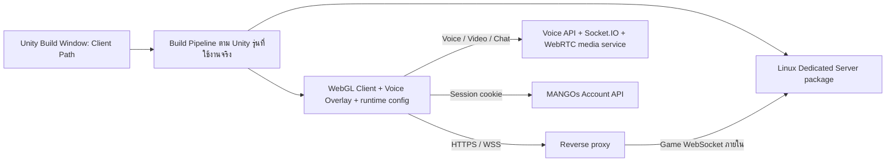

# แผนปรับปรุง MANGOs Framework: Unity 6.3, Browser Voice, Build, Avatar และ Mobile

[ภาษาไทย](MIGRATION_PLAN_TH.md) | [English](MIGRATION_PLAN_EN.md) | [เอกสารทั้งหมด / All documentation](README.md)

> เอกสารนี้เก็บแผนก่อนเริ่มลงมือไว้เป็นประวัติ ผลดำเนินงานล่าสุดและข้อจำกัดให้อ่าน [คู่มือใช้งาน](HANDOFF_TH.md) และ [ผลตรวจ](VALIDATION.md)

วันที่ตรวจ: 16 ตุลาคม 2026 — สถานะ: แผนจากการอ่านซอร์ส ยังไม่ได้เปิดโปรเจกต์ด้วย Editor ใหม่ แก้ runtime หรือทดลอง Build

## 1. เป้าหมายและขอบเขต

1. ตรวจและพยายามอัปเกรดจาก Unity `2022.3.62f3` ไปยัง `6000.3.26f1` ตามที่ผู้ใช้ระบุ หาก FishNet, glTFast, shaders หรือ IL2CPP ใช้งานกับรุ่นเป้าหมายไม่ได้ ให้หาแนวทางทดแทนก่อน หากยังไม่มีแนวทางที่ใช้งานได้ ให้ข้ามการอัปเกรด คง Unity เดิม และทำข้อ 2–5 ต่อ ตามเงื่อนไขในหัวข้อ 4.3
2. ถอดระบบ Voice เดิมของ Unity และใช้ `html-voice-tester-main` เป็นระบบสื่อสารในหน้า WebGL
3. มีเมนู Unity ที่ใช้งานทั่วไปโดยแก้เพียง `Client Path` แล้วกด Build Linux Dedicated Server, WebGL Client หรือทั้งคู่ได้ พร้อมช่องแก้ Port/WSS แยก Server และ Client: ค่าเริ่มต้น Server = `7770`, WSS unchecked; Client = `443`, WSS checked โดยเครื่องมือจัดการแพลตฟอร์มและการรวม Overlay อัตโนมัติ
4. เปลี่ยนการจัดการ Avatar ให้ใช้โครงกระดูกและ Humanoid mapping ของโมเดลแต่ละตัว พร้อมตรวจ `.anim` และระบบ Network Animator
5. ตรวจจับอัตโนมัติว่ากำลังเล่นบนคอมพิวเตอร์ โทรศัพท์ หรือ Tablet รวมทั้งแนวตั้ง/แนวนอน แล้วเลือก Controller และ layout ที่เหมาะสม รองรับการเปลี่ยนระหว่างเล่น ทั้งการเดิน กล้อง ปฏิสัมพันธ์ และโหมดบินที่มีอยู่

เอกสารนี้เป็นข้อเสนอการลงมือทำและเกณฑ์ตรวจรับ ไม่ใช่รายงานว่าได้อัปเกรดหรือแก้ปัญหาสำเร็จแล้ว ข้อความใน README/เอกสารเดิมใช้เป็นข้อมูลประกอบ ไม่ถือเป็นคำสั่งให้เปลี่ยนขอบเขตที่ผู้ใช้ร้องขอ

## 2. ข้อเท็จจริงที่ตรวจพบ

โฟลเดอร์ที่เปิดเป็น workspace คือ `C:/CosmoPC/Work/Unity/html-voice-tester-main` ส่วน Unity อยู่ข้างกันที่ `C:/CosmoPC/Work/Unity/MANGOsFramework_U6`

| ส่วน | หลักฐานจากไฟล์ในเครื่อง | ผลต่อแผน |
|---|---|---|
| Unity | `ProjectSettings/ProjectVersion.txt`: `2022.3.62f3` | ต้องทำ migration จริง แม้ชื่อ branch จะมี U6 |
| Git | `.git/HEAD`: `MANGOsFramework_U6`; config ชี้ `AlbiziaLebbeck/MANGOFramwork.git`; local branch ref `e461cdcad0b5bf7191f903afc828ea248b296a6f` | ต้องเก็บสถานะไฟล์ที่แก้ค้างก่อนเริ่ม ไม่ได้ยืนยันว่า local ตรงกับ remote ล่าสุด |
| Editor ใหม่ | พบ `6000.3.26f1` พร้อม `WebGLSupport` และ Linux server variations สำหรับ Mono/IL2CPP | ยังต้องทดสอบ compiler/toolchain และ Build จริง |
| Packages | URP `14.0.12`, Cinemachine `2.10.4`, Input System `1.14.0`, TMP `3.0.9` | ย้ายตาม compatibility ของ 6.3 และตรึงเวอร์ชันที่ผ่านทดสอบ |
| glTF loader | `com.atteneder.gltfast` เป็น Git URL ไม่ระบุ tag; lock บันทึก hash `ef121f3a88707d79c178f4d573620566b1ced6b9` | ต้อง pin dependency และตรวจ shader/runtime API |
| Build | `Assets/_Project/Scripts/Editor/BuildsScript.cs` มีเมนู Client/Server อยู่แล้ว | ต่อเติมจากเครื่องมือเดิมได้ แต่ยังไม่มีขั้นตอนประกอบแพ็กเกจและตรวจผล |
| รายการ Scene | script เดิมอ่านทุก `.unity` ในโฟลเดอร์; Build Settings มี Bootstrap → Launcher → BaseWorld และ entry ที่ปิดไว้ชื่อ TestScee | ต้องใช้รายการที่กำหนดลำดับแน่นอนและตรวจ Scene ที่มีอยู่จริง |
| Network | FishNet + Multipass + Bayou + Tugboat; prefab ตั้ง localhost, port 7770, WSS ปิด | เป็นเกมผ่าน WebSocket กับ UDP แยกจากระบบเสียง |
| Client Path | Bayou แยก `_clientAddress`, `_port`, `_useWss`, `_clientPath`; ClientSocket ใช้ `UriBuilder.Path` | ในแผนนี้หมายถึง path ของ WebSocket เช่น `/mangos/demo` ไม่ใช่โฟลเดอร์ output |
| Voice เดิม | C# manager สร้างตัวเองก่อน Scene แรก, `.jslib`, JS และ Socket.IO ใน WebGL template; `ChatCanvas` อ้าง manager | ลบเพียง GameObject ใน Scene ไม่พอ ต้องถอด bootstrap และ references |
| Voice ใหม่ | Overlay มีเสียง แชต วิดีโอ แชร์จอ สถานะพูด และ cookie authentication; room เริ่มต้น `MEA-voice` | ต้องเพิ่ม lifecycle และผูก room กับเกม |
| WebGL HTML ใหม่ | `index.html` ระบุชื่อไฟล์ `metartc.*` ตายตัว และอ้าง TemplateData/manifest ที่ไม่ได้อยู่ในชุดที่แนบ | ต้องใช้ Unity template variables และรวมไฟล์ที่จำเป็น ไม่คัดลอก HTML ทับหลัง Build ตรง ๆ |
| Web hosting ตัวอย่าง | nginx ปัจจุบันเสิร์ฟ HTTP และเลือก `viewer.html` ก่อน `index.html` | ต้องจัด entry point และ configuration สำหรับ Unity build จริง |
| Avatar | `AvatarLoader.SetupAnimator()` เลือก Resources Avatar จากชื่อวัตถุ/เส้นทางกระดูก และมี fallback `ArmatureAvatar` | เป็นจุดเสี่ยงต่อ mapping/rest pose ไม่ตรงโมเดล |
| Animator ปัจจุบัน | NetworkPlayer ทั้งแบบเดินและบินอ้าง Animator เดิม; movement/seat scripts ใช้ `GetComponent<Animator>()`; FishNet NetworkAnimator อ้าง component เดิม | การย้าย Animator ไปโมเดลใหม่ต้องปรับผู้ใช้งานทุกจุด |
| Animation | พบ Humanoid muscle curves ใน `walk_fwd.anim` เช่น `Spine Front-Back` พร้อม Root/Foot curves; Controller เดินและบินใช้ parameters ต่างกัน | มีฐานสำหรับ retarget แต่ต้องสำรวจคลิปทั้งหมด รวมคลิปที่ฝังใน FBX |
| Mobile | มี `UIJoystick`, `UITouchPanner`, `LocomotionCanvas`, Touch Action Map, Safe Area, Orientation UI | เป็นงานปรับปรุงของเดิมและเชื่อมให้ครบ |
| โหมดบิน | `BasicBehaviour`, `FlyBehaviour`, `MoveBehaviour` และกล้องอ่าน `Input.GetAxis/GetButton` | Joystick เดิมไม่ครอบคลุมโหมดนี้ ต้องมี input adapter ร่วม |

การตรวจครั้งนี้เป็น static inspection ของไฟล์ในเครื่อง ไม่ได้ fetch repository, ยืนยัน working tree ว่าสะอาด, ติดต่อ production API, ทดสอบ login/microphone หรือรัน Server

## 3. สถาปัตยกรรมที่เสนอ



Unity Server ดูแลโลก ผู้เล่น และสถานะเกม ส่วน Browser Overlay ดูแล microphone และ media ใช้ช่องทาง WebRTC ของระบบใหม่ ไม่ส่งเสียงผ่าน FishNet การรวมไฟล์ Overlay เข้า Client ไม่ได้สร้าง Voice backend หรือ TURN server ขึ้นมาใหม่

## 4. งานที่ 1 — อัปเกรด Unity เป็น 6000.3.26f1

### 4.1 เก็บ baseline และทางย้อนกลับ

- ตรวจ Git diff/untracked และรักษางานที่ทำค้างทั้งหมด สร้าง checkpoint พร้อม branch สำหรับ migration ก่อนเปิดด้วย Editor ใหม่
- เก็บ `Assets`, `.meta`, `Packages`, `ProjectSettings`, build/deploy configuration และตัวอย่าง Build เดิมที่ใช้งานได้ เก็บ Editor 2022 ไว้สำหรับเปรียบเทียบ
- บันทึกภาพและพฤติกรรม: Login, เข้าโลก, ผู้เล่นสองคน, เปลี่ยน Avatar, เดิน/บิน, นั่ง, interaction และการเชื่อมต่อ server
- บันทึก versions ของ FishNet/Bayou รวมการแก้ vendor code ที่มีในโปรเจกต์ โดยเฉพาะ `_clientPath` เพื่อไม่ให้ package update เขียนทับ
- สำรวจ dependencies ที่ฝังใน Assets, DLL, shaders, renderer features และ AssetBundle/Addressables ที่ใช้จริง หากมี bundles จาก Editor เก่าต้องกำหนดแผน rebuild ให้ตรงรุ่น

### 4.2 ย้าย Editor และแก้ compatibility เป็นชุด

1. ใช้สำเนาหรือ checkout สำหรับ migration เปิดด้วย `6000.3.26f1`; อ่านคู่มือการเปลี่ยนแปลงระหว่าง 2022 → 6.0 → 6.1 → 6.2 → 6.3 แม้ทดลองเปิดตรงที่ 6.3
2. ให้ Package Manager resolve ชุดที่รองรับ 6.3 แล้วตรึง manifest/lock ไม่ใช้การอัปเดตทุก package เป็น latest พร้อมกัน
3. ย้าย URP 14 ไปสายที่รองรับ Editor เป้าหมาย โดยตรวจ Renderer Assets, Volume, Shader Graph, แสง เงา Transparency และ shader ของ Avatar ที่โหลด runtime
4. ใช้ Render Graph เป็นเป้าหมายสำหรับงานส่งมอบ เอกสาร 6.3 ระบุว่า Compatibility Mode ถูกถอดจากเส้นทางปกติและ define สำหรับ migration เป็นทางชั่วคราว หากมี render pass เก่าซับซ้อน ให้พิจารณาใช้ 6.0–6.2 เป็นขั้นกลางเฉพาะงานนี้ ไม่กำหนดให้ติดตั้งทุกรุ่นล่วงหน้า [คู่มือ Unity 6.3](https://docs.unity3d.com/6000.3/Documentation/Manual/UpgradeGuideUnity63.html)
5. ตรวจ Cinemachine 2.x กับ Editor ใหม่ก่อนคงหรือเปลี่ยนรุ่น การย้ายเป็น Cinemachine 3 ต้องมีเหตุผลและเป็นงานแยก เพราะโค้ดเดิมอ้าง `CinemachineVirtualCamera`/`CinemachineFramingTransposer`
6. แก้ Input System/uGUI/TMP และ API ที่เปลี่ยน รวม `.jslib`, Emscripten interop, FishNet code generation, stripping และ IL2CPP/AOT
7. ตรวจ Linux cross compiler และ WebGL toolchain จาก Build จริง ไม่สรุปว่าพร้อมจากการมีโฟลเดอร์ module อย่างเดียว
8. Build Server และ Client ชุดเล็กให้ผ่านก่อนเริ่ม redesign Avatar เต็มระบบ

เกณฑ์ผ่าน: Editor ไม่มี compile error, Scene/Prefab ไม่มี missing scripts ที่เกิดจาก migration, ภาพไม่เสีย, Linux server เริ่มได้ และ WebGL สอง Client เข้าโลกเดียวกันพร้อมเห็นการเคลื่อนไหวได้

### 4.3 เงื่อนไขหาแนวทางทดแทนและข้ามการอัปเกรด

เงื่อนไขเพิ่มเติมจากผู้ใช้: การอัปเกรด Unity ไม่เป็นเงื่อนไขบังคับให้งานข้อ 2–5 ต้องหยุดรอ หากตรวจ FishNet, glTFast, shaders หรือ IL2CPP แล้วพบว่าใช้กับ `6000.3.26f1` ไม่ได้ ให้ดำเนินการตามลำดับนี้

1. แยกปัญหาและเก็บหลักฐานที่ทำซ้ำได้ เช่น compile/build log, runtime error หรือภาพ shader ที่แสดงผลผิด พร้อมระบุ dependency/version และ target ที่ได้รับผลกระทบ ไม่สรุปว่าอัปเกรดไม่ได้จาก error ที่ยังไม่ตรวจสาเหตุ
2. ค้นหาและทดลองแนวทางที่เหมาะสม โดยประเมินผลต่อระบบเดิมและงานข้ออื่นตามตารางด้านล่าง

| ส่วนที่ไม่เข้ากัน | แนวทางที่ต้องพิจารณาก่อนข้ามการอัปเกรด |
|---|---|
| FishNet/Bayou | รุ่นหรือ patch ที่รองรับ Unity เป้าหมาย พร้อมรักษาการแก้ Client Path เดิม; ตรวจ code generation/transport และทดสอบ multiplayer จริง หากต้องใช้ transport หรือ networking อื่น ให้ประเมินขอบเขตการย้ายและความสามารถที่ต้องทดแทนก่อนเลือก |
| glTFast | รุ่นที่รองรับและตรึงเวอร์ชันได้ หรือ importer อื่นที่รองรับ GLB/VRM และ runtime WebGL ตามความต้องการ โดยทดสอบวัสดุ animation และการคืน memory |
| shaders/URP | ปรับ shader, Shader Graph หรือ render pass ให้รองรับ pipeline เป้าหมาย หรือใช้ shader/material ที่ให้ผลเหมาะสมแทน พร้อมตรวจภาพ Avatar และฉาก |
| IL2CPP/AOT | แก้ toolchain, package/native plugin, AOT และ stripping ตามสาเหตุ แล้วทดสอบ Linux Server และ WebGL; การเปลี่ยน backend ฝั่ง Server อย่างเดียวไม่ถือว่าแก้ข้อจำกัด WebGL สำเร็จ |

3. ใช้แนวทางทดแทนเมื่อทดสอบแล้วผ่านเกณฑ์ Server/WebGL และรักษาความสามารถที่จำเป็นได้ บันทึกสิ่งที่เปลี่ยนและผลกระทบไว้ในรายงาน migration
4. หากยังหาแนวทางที่ใช้งานได้ไม่พบ ให้กำหนดผลขั้นอัปเกรดเป็น **Skipped — compatibility unresolved** บันทึกสาเหตุ แนวทางที่ลอง และเงื่อนไขที่จะกลับมาทำภายหลัง โดยไม่ระบุว่าการอัปเกรดสำเร็จ
5. กลับไปใช้ baseline Unity `2022.3.62f3` ที่เก็บไว้ รักษางานเดิมของผู้ใช้และแยกการทดลอง migration ไว้ ห้ามนำ Assets/ProjectSettings ที่แปลงด้วย Unity 6 ไปเปิดย้อนใน 2022 โดยตรง
6. ดำเนินงาน **ข้อ 2 ระบบเสียง, ข้อ 3 เมนู Build, ข้อ 4 Avatar และข้อ 5 Mobile Controller** ต่อบน Unity เดิม ตามลำดับส่งมอบในหัวข้อ 9 โดยไม่ต้องรอแก้ compatibility ของ Unity 6 สำเร็จ ปรับ dependency/API และเกณฑ์ทดสอบให้ตรงกับ Editor ที่ใช้จริง

สำหรับเส้นทางที่ข้ามการอัปเกรด ให้ใช้ `EditorWindow` + `BuildPipeline` ที่รองรับ Unity 2022 แทน API Build Profiles เฉพาะ Unity 6 และตรวจ runtime importer, browser support และประสิทธิภาพมือถือบน Unity 2022 จริง ความสำเร็จของงานข้อ 2–5 ตรวจรับแยกจากสถานะอัปเกรด และรายงาน Editor version ของชุดส่งมอบอย่างชัดเจน

## 5. งานที่ 2 — ถอด Voice เดิมและรวม html-voice-tester-main

### 5.1 ถอดระบบเดิมให้ครบเส้นทาง

- ไล่ references ของ `Assets/_Modules/VoiceCommunication`, `Assets/Plugins/WebGL/VoiceCommunication.jslib`, `Assets/WebGLTemplates/MANGOsPWA/VoiceCommunication` และ config/assets ที่ใช้ชนิดข้อมูลเหล่านี้
- ถอด RuntimeInitialize bootstrap, native JS imports, template `<script>`, UI listeners และ microphone callbacks ของระบบเดิม
- ปรับ `ChatCanvas`, mic/video icons, network mic state และ UnityEvents ใน Prefab/Scene ให้ตรงกับ UI ใหม่ ไม่ปล่อย reference ให้หายหลังลบไฟล์
- เก็บเสียงเกม เช่น footsteps, ดนตรี และเสียงวัตถุ งานนี้ถอดระบบสื่อสารเสียง ไม่ใช่ AudioSource/AudioListener ทั้งโปรเจกต์
- WebGL ใช้ Overlay เป็น UI หลักด้านการสื่อสาร ตรวจการซ้ำกับ text chat เดิมก่อนย้ายแชต เพราะแชตระบบเกมอาจใช้กับ interaction หรือช่องทางอื่น ให้รักษาเส้นทางที่จำเป็นจนกว่าจะทดสอบทดแทนได้ครบ

### 5.2 รวมเป็น WebGL template ที่ Build ซ้ำได้

1. จัดเก็บ `voice-app.js` และ `voice-overlay/` ภายใต้แหล่งไฟล์ใน Unity project หรือ dependency ที่ตรึง revision ไว้ ไม่อ้าง absolute path บนเครื่องผู้พัฒนา
2. ใช้ template เดิมเป็นฐานรวม UI และ authentication โดยเปลี่ยนส่วน loader ให้ใช้ Unity template variables สำหรับชื่อ data/framework/wasm/loader และ compression ตาม Build จริง
3. โหลด Overlay เพียงครั้งเดียวและหลังตั้งค่า public runtime config ตรวจ MIME สำหรับ ES modules และ relative URL เมื่อ deploy ใต้ subdirectory
4. เพิ่ม API lifecycle ให้ Overlay เช่น `initialize`, `setSession`, `setRoom`, `leave`, `dispose` โดยชื่อเหล่านี้เป็น API ที่เสนอให้สร้าง ยังไม่มีครบในโค้ดปัจจุบัน
5. สร้าง C#/JS bridge บาง ๆ สำหรับส่ง room และสถานะผู้เล่น ไม่ย้าย microphone logic กลับเข้า Unity
6. ทำให้ Unity ส่งเหตุการณ์เมื่อ spawn สำเร็จ เปลี่ยนโลก disconnect และ logout ส่วน Browser ส่งสถานะ mute/speaking กลับเฉพาะเมื่อเกมต้องแสดง icon เหนือหัว

### 5.3 ห้องเสียง ตัวตน และอุปกรณ์

- ใช้ world/session identifier ที่ Server ยืนยันแล้วเป็น room key พร้อม deployment namespace ตามจำเป็น ไม่ตั้งทุก deployment เป็น `MEA-voice` และไม่ใช้ Client Path แทน world id โดยอัตโนมัติ
- ก่อน spawn หรือขณะเปลี่ยนห้อง ให้ปิดการเข้าห้องเก่า/หยุด tracks และ subscriptions แล้วผูกห้องใหม่อย่างมีลำดับ ไม่เปิด microphone ซ้ำจาก Overlay สอง instance
- `getVoiceConfig()` ปัจจุบันอ่าน config ตอนเริ่ม และ speaking sender เก็บ room ไว้ จึงต้องแก้ทั้ง Voice/Chat/Video/Speaking lifecycle ไม่ใช่แก้ global `roomId` อย่างเดียว
- รักษา cookie auth (`credentials: include`) และทดสอบ CORS, SameSite, cookie domain และการจำกัด cookie ของ Safari หาก host deployment เป็นคนละ site จริง ให้กำหนด flow ที่ backend รองรับ ห้ามใส่ token ลับใน Build config
- เชื่อม account user id กับ network player/session อย่างชัดเจน เพราะ Unity UID แบบ uint กับ Overlay participant id เป็นคนละชนิด และบัญชีเดียวเปิดหลายแท็บได้ ไม่ใช้ display name เป็น identity
- ปรับ auth polling ให้รับรู้ logout/account switch ด้วย ปัจจุบัน poller หยุดตรวจหลังพบ user แล้ว
- เริ่ม capture/playback ผ่านการแตะหรือคลิกที่รองรับ browser policy; มีสถานะ denied, ไม่มีไมค์, disconnected และการกลับจาก background
- โค้ดใหม่เรียก `/api/v1/ice-servers` และมี STUN fallback อยู่แล้ว ต้องตรวจว่าคำตอบให้ TURN ที่ใช้งานได้จริงผ่านเครือข่ายจำกัด/มือถือ ไม่ถือว่า fallback STUN ครอบคลุมทุกเครือข่าย
- เปิด Screen Share ตาม capability ของ browser อุปกรณ์ที่ไม่รองรับต้องแสดงสถานะเหมาะสม เสียงและการเดินยังใช้งานได้
- ตรวจ partial failure เช่น join สำเร็จแต่ขอไมค์ไม่ผ่าน ต้อง cleanup room/socket/tracks และ retry โดยไม่เกิด participant ค้าง

เกณฑ์ผ่าน: เสียงใหม่ทำงานเพียงชุดเดียว, ห้อง A/B ไม่ได้ยินกัน, ผู้ใช้สองบัญชีคุยได้, mute/leave/login/logout ถูกต้อง, เปลี่ยนโลกไม่ค้างห้องเดิม, ต่อใหม่หลังหลุดได้ และเกมยังเล่นต่อได้เมื่อบริการเสียงขัดข้อง

## 6. งานที่ 3 — เมนู Build พร้อมค่าเริ่มต้นและช่องแก้ Port/WSS

### 6.1 หน้าต่างที่ผู้ใช้ใช้งาน

เมนูเสนอ: `MANGOs Framework > Build Center`

```text
Client Path: [/mangos/demo]

Server Settings
  Port: [7770]     WSS: [ ]

Client Settings
  Port: [443]      WSS: [x]

[Build Server]  [Build Client]  [Build Both]

Profile: Production       (ค่าที่ทีมตั้งไว้)
Server: Linux Dedicated   Client: WebGL
Output: Builds/<deployment>/<build-id>/

[Save Profile]  [Reset Network Defaults]
```

ช่อง Port และ checkbox WSS ของทั้งสองฝั่งต้องแก้ได้โดยตรงใน Build Center ไม่ต้องแก้ Inspector หรือ source code ค่าเริ่มต้นใช้เมื่อสร้าง profile ใหม่หรือกด Reset Network Defaults เท่านั้น บันทึกค่าที่ผู้ใช้แก้แยกตาม profile และห้ามปุ่ม Build เขียนทับกลับเป็น default โดยเงียบ ๆ การ Build ตามค่าปกติยังคงแก้เพียง Client Path ได้

อ้างอิง `_clientPath` ของ Bayou ที่พบในโค้ด จึงวางแผนให้ช่องนี้รับ URL path เช่น `/mangos/demo` ถ้าต้องการเปลี่ยนโดเมนด้วยในอนาคต ให้รองรับ full WSS URL เป็นโหมดเพิ่มเติมพร้อม validation อย่าแยก host/path ด้วยวิธีเดาสตริง

ข้อจำกัดที่ต้องจัดการครั้งแรก: path เพียงค่าเดียวไม่สามารถระบุ hostname, TLS certificate และตำแหน่ง deploy ที่ไม่เคยตั้งค่าได้ จึงต้องมี Deployment Profile และ reverse proxy mapping ที่พร้อมก่อน หลังจากนั้นการ Build ประจำวันแก้เฉพาะ Client Path ได้ และปรับ Port/WSS ในหน้าต่างเดียวกันเมื่อ deployment ต้องใช้ค่าต่างออกไป

### 6.2 นโยบายเครือข่าย

| ฝั่ง | Port เริ่มต้น | WSS เริ่มต้น | ความหมายและการแก้ค่า |
|---|---|---|---|
| Server | `7770` | unchecked | Bayou listen port และการเปิด TLS ที่ Server; แก้ได้อิสระจาก Client |
| Client | `443` | checked | พอร์ตปลายทางและ scheme ที่ WebGL ใช้เชื่อมต่อ; แก้ได้อิสระจาก Server |

การตั้งค่าปกติคือ Client ต่อ `wss://<configured-host>:443/<client-path>` ผ่าน reverse proxy ที่ทำ TLS termination แล้วส่ง WS ไป Server port `7770` ดังนั้นสองฝั่งมี Port/WSS ต่างกันได้ ส่วน Local Development ตั้งเป็น WS และพอร์ตที่ต้องการผ่านช่องเดิมแล้วบันทึกใน profile แยกได้

ต้องแปลงค่าจาก UI ไปใช้ให้ถูกฝั่ง: `_useWss` ของ Bayou เป็นการเชื่อมต่อของ Client; checkbox Server WSS ต้องควบคุม SSL configuration ฝั่ง Server ไม่ใช้ client flag แทน เมื่อเปิด Server WSS ให้มีช่องเลือก certificate configuration ฝั่ง Server และตรวจว่าพร้อมใช้งาน โดยไม่บรรจุ private key/password ลง WebGL Client หากมี native/Editor client ที่ใช้ Tugboat ให้เก็บ UDP configuration แยกจาก Bayou TCP

ตรวจ Port ให้อยู่ในช่วง `1–65535` และตรวจความสอดคล้องของ scheme, hosting และ TLS topology เช่น Client WS บนหน้า HTTPS หรือ Server WSS ที่ไม่มี certificate configuration ให้แสดงปัญหาและค่าที่ต้องแก้ก่อน Build โดยไม่เปลี่ยนค่าที่ผู้ใช้เลือกเอง

สร้าง proxy configuration ตัวอย่างจาก Client Path และค่า Port/WSS ที่เลือก รวม WebSocket Upgrade, timeout, upstream scheme และ rewrite ที่ตรงกับ Bayou พร้อม WebGL headers/MIME/compression ไม่ deploy หรือแก้ proxy ที่ใช้งานจริงจากปุ่ม Build โดยปริยาย

### 6.3 ลำดับ Pipeline

Pipeline ต้องรองรับ Editor ที่เลือกหลังผ่านหัวข้อ 4.3: ใช้ Build Profiles ได้เมื่ออัปเกรดสำเร็จ ส่วนเส้นทาง Unity 2022 ใช้ configuration ของเครื่องมือเองร่วมกับ `BuildPipeline` โดยยังคงหน้าต่างและปุ่ม Build แบบเดียวกันสำหรับผู้ใช้

1. ตรวจ Editor version, modules, scenes, writable output, path, Server/Client Port/WSS, TLS configuration, overlay assets และ profile ก่อนเริ่ม
2. ใช้ `EditorBuildSettings` ที่เปิดใช้งานหรือ scene list ใน profile เรียง `Bootstrap → Launcher → BaseWorld` และ world ที่ต้องใช้ ห้ามใส่ Test scene จากการกวาดโฟลเดอร์
3. สร้าง public runtime configuration สำหรับ Client และ server configuration จาก profile เดียวกัน โดยใช้ Port/WSS ของแต่ละฝั่งตามค่าที่ผู้ใช้บันทึก พร้อม build id/protocol version; ค่า override ต้องปรากฏใน manifest และ proxy example ที่สร้างด้วย
4. Server: เลือก `StandaloneLinux64` + Dedicated Server subtarget และกำหนด output ชื่อ `MANGOsServer.x86_64`; ตรวจ IL2CPP ตาม toolchain ที่ผ่าน baseline
5. Client: เลือก WebGL และ template ที่รวม Overlay; เลือก texture/compression policy ที่ผ่าน Desktop+Mobile test ไม่บังคับ ASTC ชุดเดียวจาก script เดิมโดยไม่มี fallback
6. จัด Build Both เป็นลำดับที่หยุด/ทำต่อได้เมื่อ Unity เปลี่ยน platform แล้ว compile/domain reload ใช้ job state ที่เก็บข้าม reload หรือ batchmode แยก process ตามความเหมาะสม ไม่อาศัย static variables หรือ try/finally อย่างเดียว
7. อย่าแก้ Prefab/Scene ต้นฉบับเพื่อสลับ WSS/port ไปมา ใช้ runtime config หรือ build-time processing กับสำเนาของ Scene และกำหนด startup ordering ให้ config พร้อมก่อน NetworkManager เริ่มเชื่อมต่อ
8. อ่าน `BuildReport` ทุก target ถ้าตัวใดล้มเหลว ให้รายงานว่าไม่ครบคู่และไม่แทนที่ release ล่าสุดที่ผ่าน ใช้ staging output ก่อนเลื่อนไปเป็นชุดสมบูรณ์
9. คืนค่า Editor/profile ชั่วคราวเมื่อจบ ยกเลิก หรือเกิดข้อผิดพลาด และเก็บ log สำหรับแต่ละ target
10. ตรวจเนื้อหา output, เขียน manifest และแสดงตำแหน่งพร้อมเปิดโฟลเดอร์ได้

ไฟล์ Server ต้องส่งเป็นแพ็กเกจทั้งชุด เช่น `.x86_64`, `_Data`, libraries และ runtime files ที่ Unity สร้าง ไม่ใช่คัดลอก executable ตัวเดียว จัด permission/launch script สำหรับ Linux ไว้ในแพ็กเกจด้วย

```text
Builds/<deployment>/<build-id>/
  Server/   MANGOsServer.x86_64 + data/libraries/config
  Client/   index.html + Build/ + TemplateData/ + StreamingAssets/
            voice-app.js + voice-overlay/ + public-runtime-config.json
  Deploy/   proxy example + start script + deployment notes
  build-manifest.json
  Logs/
```

เกณฑ์ผ่าน: เริ่มจาก Editor ที่อยู่คนละ platform แล้ว Build Both ได้; profile ใหม่มี Server `7770`/WSS unchecked และ Client `443`/WSS checked; แก้ Port/WSS แยกฝั่ง บันทึก เปิดหน้าต่างใหม่ และ Build แล้วค่านั้นยังถูกใช้จริงโดยไม่ต้องแก้ Inspector; ค่าฝั่งหนึ่งไม่เขียนทับอีกฝั่ง; Reset คืนค่าตามที่กำหนด; output ไม่มีชื่อ `metartc` ตายตัว ทุกไฟล์ครบ Build ซ้ำได้ และ Server/Client ชุดนั้นเชื่อมต่อกันจริงผ่าน path และ TLS topology ที่ตั้ง

## 7. งานที่ 4 — Avatar, .anim และกระดูก

### 7.1 วิธีที่ระบบเดิมทำงานและสมมติฐานปัญหา

Account ให้ URL → ส่ง URL ด้วย FishNet SyncVar → `AvatarLoader` ใช้ glTFast โหลด model → เลือก Unity Avatar asset จากชื่อ hierarchy → ใส่ Animator → ใช้ Controller เดิม → Rebind

Unity Avatar ในที่นี้คือ mapping และข้อมูล Humanoid/rest pose ไม่ใช่ mesh ที่เห็นบนหน้าจอ ส่วน `.anim` เก็บการเคลื่อนไหว และ Animator Controller เลือก state/blending จาก parameters การใช้ Controller ร่วมกันทำได้ แต่ mapping ต้องตรงกับโมเดลที่ใช้

หลักฐานที่น่าสงสัยคือโมเดลต่างตัวใช้ prebuilt Avatar จาก Resources และ fallback เดียวกัน การที่ชื่อกระดูกคล้ายกันไม่ยืนยันว่า bone lengths, local axes, parent transforms หรือ T-pose ตรงกัน อาการยืด/หดจึงอาจมาจาก mapping/rest pose ผิด อย่างไรก็ดี ยังต้องทดสอบโมเดลที่มีปัญหาเพื่อแยกจาก skin weights, bind matrices, scale หรือ animation curves ที่ผิดตั้งแต่ต้น

### 7.2 โครงสร้างใหม่

```text
NetworkPlayerRoot
  NetworkObject / movement / CharacterController / camera anchors
  AvatarVisualRoot
    Model ที่โหลดมา
      mesh + skeleton ของโมเดลตัวนั้น
      Animator + Unity Avatar ที่สร้าง/โหลดสำหรับ skeleton นี้
```

แชร์ movement และ state/parameters ของ animation ข้ามโมเดล เก็บ skeleton, skin weights และ inverse bind matrices ของแต่ละโมเดลไว้ ไม่ยืดแขนขาให้เข้ากระดูกสำเร็จรูป

ใช้บริการอ้างอิง Animator ที่ใช้งานจริง เช่น `AvatarRuntimeContext`/`PlayerAnimationDriver` แล้วปรับ movement, NetworkAnimator, fly behaviour, seat, special move, event receivers และ reset animator ให้ใช้แหล่งอ้างอิงเดียวกัน แทนการหา root Animator ที่ถูกเปลี่ยนไปแล้ว

### 7.3 ขอบเขตการรองรับ

| ชนิด Avatar | วิธีที่เสนอ | ขอบเขตที่รับประกันหลังทดสอบ |
|---|---|---|
| VRM 1.0 | ใช้ UniVRM runtime importer และ metadata Humanoid ของไฟล์ | ตัวเลือกหลักสำหรับคนที่ใช้กระดูกตนเอง |
| VRM 0.x | โหลดด้วย path ที่รองรับ conversion ไป VRM 1.0 | ต้องทดสอบวัสดุ ทิศหน้า expressions และ spring bones |
| GLB humanoid ที่มี mapping | ใช้ glTFast หรือ importer ที่เลือก พร้อมสร้าง Unity Avatar ต่อโมเดล | รองรับเมื่อ hierarchy/rest pose/skin ผ่าน validation |
| GLB humanoid ไม่มี mapping | หา mapping ด้วย profile/aliases แล้วให้ยืนยันหรือทำ preprocessing ที่ upload | ไม่เดาว่าสำเร็จจากชื่อกระดูกอย่างเดียว |
| GLB non-humanoid หรือไม่มีกระดูก | Generic animation ของโมเดลเอง/adapter เฉพาะ/fallback | ใช้ชุดท่าคนร่วมกันอัตโนมัติทุกตัวไม่ได้ |

UniVRM ระบุการรองรับ runtime import, VRM 0.x/1.0, IL2CPP และ WebGL จึงเหมาะเป็นตัวเลือกที่ต้องทำ prototype ใน `6000.3.26f1` และ URP เป้าหมายก่อนเลือก tag จริง [UniVRM repository](https://github.com/vrm-c/UniVRM)

สำหรับ GLB ที่ไม่มี Humanoid metadata สร้าง `HumanDescription` จาก transforms และ rest pose ของโมเดลนั้นแล้วใช้ `AvatarBuilder.BuildHumanAvatar` พร้อมตรวจ `isValid`/`isHuman`; การมี API นี้ไม่ได้แปลว่าสามารถเดา mapping ของ GLB ทุกไฟล์ได้ [Unity API](https://docs.unity3d.com/6000.3/Documentation/ScriptReference/AvatarBuilder.BuildHumanAvatar.html)

### 7.4 ลำดับลงมือทำ

1. ทำ diagnostic scene และรายงานแต่ละโมเดล: format/version, skeleton tree, required bones, duplicates, scale, pose, skinned meshes, bone references, height และ material errors
2. สำรวจ `.anim` และ clips ใน FBX ที่ Controller ใช้ ตรวจ Humanoid/Generic, animation masks, root motion, position/scale curves, IK และ events แยกตาม Controller เดิน/บิน/interaction คลิป Generic ไม่สามารถแค่เปลี่ยน flag เป็น Humanoid ต้อง reimport/retarget จากต้นฉบับหรือทำ conversion ที่ถูกต้อง
3. ทำ prototype ด้วยโมเดลเดิมหนึ่งตัว โมเดลที่เคยผิดหนึ่งตัว และ VRM สัดส่วนต่างกัน ยืนยันว่าใช้ Animator กับ Avatar ของโมเดลนั้นจริงก่อนรื้อ loader ทั้งหมด
4. แยก loader ตามเนื้อหา/metadata ไม่อาศัยนามสกุล URL อย่างเดียว เพราะ URL อาจมี query หรือไม่ลงท้ายด้วย `.vrm`
5. ทำ mapping/rest pose validation โดยไม่แก้ bind pose เดาสุ่ม หากต้อง normalize A/T-pose ต้องใช้ importer/กระบวนการที่รักษาความสอดคล้องกับ mesh skin
6. กำหนด human limits และ arm/leg stretch อย่างระมัดระวัง ลด IK stretching และทดสอบ foot sliding/มือเอื้อม ไม่ใช้ IK เป็นการกลบ mapping ที่ผิด
7. ปรับ CharacterController, ground probe, camera target, nameplate และ seat offsets จาก metric/profile ของ Avatar ใช้ uniform scale ที่ VisualRoot หากต้อง normalize ความสูง หลีกเลี่ยง non-uniform scale ของแต่ละ bone; กำหนดช่วง collider ที่ Server ยอมรับให้สอดคล้องกับ collision ของเกม
8. ให้ Server ส่ง avatar descriptor/id, content version และ animation state ส่วน Client โหลดโมเดลเอง ไม่ส่ง bone transforms ทุกข้อเมื่อใช้ Humanoid state ร่วมกันได้ และไม่ให้ Server ต้องดาวน์โหลด/render Avatar
9. ตรวจ FishNet NetworkAnimator ว่าเปลี่ยน Animator ตอน runtime ได้อย่างถูกต้องหรือไม่ หากข้อจำกัดไม่เหมาะ ให้ sync parameter/state ผ่าน animation driver ที่ออกแบบไว้ พร้อม late join และเปลี่ยนโมเดลกลาง state
10. แยก parameter schema ของ Controller เดิน/บิน อย่าฝืนใส่ Controller เดียวให้ทุก mode โดยไม่ปรับ adapter
11. แก้ async race/cancellation เมื่อเปลี่ยน Avatar รัว ๆ ให้ผลโหลดล่าสุดเท่านั้นเป็นตัว active; เก็บตัวเก่าไว้จนตัวใหม่พร้อม แล้ว dispose importer/materials/textures ที่เลิกใช้ตาม ownership
12. เปลี่ยน cache จากจำนวน 100 โมเดลอย่างเดียวเป็น memory budget + eviction ที่เหมาะกับมือถือ และเก็บ mapping cache แยกจาก live Animator
13. เมื่อไฟล์ผิดหรือ mapping ไม่ครบ แสดงเหตุผลที่แก้ได้และใช้ fallback ที่ปลอดภัย หลีกเลี่ยงลูป retry/rebind ที่ไม่อาจแก้ไฟล์ต้นทางได้

เกณฑ์ผ่าน: โมเดลชุดทดสอบใช้กระดูกของตนเองและไม่ยืด/หดผิดรูปใน idle, เดิน, วิ่ง, กระโดด, หมอบ, นั่ง, บินและ emote ที่เกี่ยวข้อง; local/remote/late join เห็นตรงกัน; เปลี่ยนซ้ำไม่ทำให้ memory โตต่อเนื่อง; โมเดลไม่รองรับมี fallback พร้อมเหตุผล

คำตอบเรื่อง “ใช้ Avatar อะไรก็ได้”: ทำได้กว้างขึ้นมากสำหรับ humanoid ที่ rig/skin ถูกต้อง โดยเฉพาะ VRM แต่รับประกันไฟล์ GLB/VRM ทุกไฟล์ไม่ได้ ความสูงต่างกันแก้ได้ด้วย retarget และ body metrics ส่วนไฟล์ที่ไม่มี rig หรือ skin เสียต้องผ่านกระบวนการเตรียมโมเดลเพิ่ม

## 8. งานที่ 5 — ตรวจอุปกรณ์/แนวหน้าจอและเลือก Controller อัตโนมัติ

### 8.1 ใช้ของเดิมเป็นฐานและแก้จุดที่ตรวจพบ

- ต่อ `UIJoystick`/`UITouchPanner` กับ input state กลาง แยกเจ้าของ pointer ของแต่ละนิ้วให้เดิน หมุนกล้อง และกดปุ่มพร้อมกันได้
- แก้เส้นทาง disable ที่ใช้ `FindAction(mapString)` กับชื่อ Action Map เป็นการจัดการ Action Map ที่ถูกต้อง แล้วตรวจ enable/disable event lifecycle เมื่อเปลี่ยน Scene/UI
- ปรับการคำนวณ joystick radius/sprint และการแปลง screen point ไป Canvas space ให้สม่ำเสมอในหลายความละเอียด
- ตรวจการหมุนกล้องที่เทียบแค่ขนาด delta กับค่าก่อนหน้า เพราะ delta เท่ากันต่อเนื่องอาจถูกข้าม ใช้การประมวลผล input ที่ไม่ทำให้กล้องสะดุด
- ตรวจ UI raycast ที่อ้าง `Input.mousePosition` ให้ใช้ touch/pointer ที่ถูกตัว และไม่ให้ tap เพื่อเปิดเสียงกลายเป็นคำสั่งเดิน
- ปรับ device detection จาก UA regex อย่างเดียว ให้พิจารณา touch/pointer capability และมีสวิตช์เลือกโหมดบน iPad ที่ใช้ desktop UA หรือ Tablet ที่ต่อคีย์บอร์ด
- Safe Area เดิม refresh ใน Awake เท่านั้น เพิ่ม resize/orientation/browser toolbar changes และให้ DOM Overlay ใช้พื้นที่ปลอดภัยชุดเดียวกัน

### 8.2 การควบคุมที่เสนอ

| พื้นที่/ปุ่ม | โหมดเดิน | โหมดบิน |
|---|---|---|
| Joystick ซ้าย | เดิน/วิ่ง | เคลื่อนที่แนวราบ |
| ลากพื้นที่ขวา | หมุนกล้อง | หมุนกล้อง |
| Jump / Action | กระโดด/ใช้วัตถุ/นั่ง | Action ที่เหมาะสม |
| Fly toggle + Up/Down | แสดงเมื่อมีสิทธิ์บิน | บินขึ้น/ลงและลงจอด |
| Voice tray | เข้าร่วมเสียง/mute/chat | เหมือนโหมดเดิน |
| Pinch/zoom | มีเมื่อพื้นที่และ gesture ไม่ชนกัน | ปรับตามกล้อง |

ให้ทั้ง Starter Assets และโหมดบินอ่าน `Move/Look/Jump/Sprint/Fly/VerticalMove/Interact` ผ่าน adapter ร่วม โดย keyboard/mouse และ touch ส่งเข้า contract เดียวกัน ไม่จำลองปุ่มคีย์บอร์ดจากหน้าจอ

ตอนพิมพ์แชต เปิด modal หรือเรียก browser permission ให้หยุด input ที่เกี่ยวข้องและล้างค่าสะสม ปล่อยนิ้วนอกปุ่ม, pointer cancel, blur, background หรือ disconnect ต้องหยุดเดิน/บินทันที DOM Overlay และ Unity Canvas ต้องตกลงกันว่า pointer อยู่กับใคร เพื่อไม่ให้เปิดแชตแล้วตัวละครเดินต่อ

Unity 6.3 มีรายการ mobile browsers ที่รองรับ แต่ประสิทธิภาพของโลก Avatar และ WebRTC ต้องทดสอบแยกบนอุปกรณ์จริง [Unity browser compatibility](https://docs.unity.com/en-us/engine/6000.3/manual/platform-specific/webgl/intro/browsercompatibility)

### 8.3 ตรวจจับอุปกรณ์และแนวหน้าจอระหว่างเล่น

ระบบต้องมีสถานะกลางสำหรับ `DeviceFamily` (Desktop/Phone/Tablet/Unknown), `Orientation` (Portrait/Landscape), input ที่ใช้งาน และ Controller/layout ปัจจุบัน โดยส่งสถานะเดียวกันให้ Unity UI, movement/camera และ DOM Voice Overlay ใช้ร่วมกัน

- ประเมินตอนเปิดหน้าเว็บ ก่อนเปิด Controller และเมื่อ viewport/orientation หรืออุปกรณ์ input เปลี่ยน โดยใช้ข้อมูล browser/platform ร่วมกับ touch/pointer capability และขนาดพื้นที่เล่น ไม่ตัดสินจาก UA regex หรือความกว้างจออย่างเดียว
- กำหนด heuristic สำหรับ Phone/Tablet และ iPad desktop UA พร้อมบันทึกผลตรวจไว้ใน diagnostics เพื่อทดสอบ ระบบต้องมี fallback ตาม input capability เมื่อระบุประเภทเครื่องได้ไม่แน่ชัด เพราะข้อมูล browser ไม่รับประกันการแยกประเภทอุปกรณ์ได้ทุกเครื่อง
- คอมที่มี touchscreen ยังต้องใช้ keyboard/mouse ได้ ส่วน Tablet ที่ต่อ keyboard/mouse ต้องเลือก input ที่เหมาะกับการใช้งานปัจจุบัน โดยไม่สูญเสียโหมด touch ที่ผู้ใช้ต้องการ
- ตรวจแนวตั้ง/แนวนอนของพื้นที่เล่นและรับเหตุการณ์หมุนจอ/resize ระหว่างเล่น แยกการเปลี่ยนแนวจริงออกจาก viewport ที่หดเพราะ soft keyboard เพื่อลดการสลับ Controller ผิดจังหวะ
- ใช้โหมด `Auto` เป็นค่าเริ่มต้น พร้อมตัวเลือก override อุปกรณ์/input สำหรับกรณีตรวจไม่ตรง; เก็บ override ของผู้ใช้และมีคำสั่งกลับ Auto ได้ ไม่บังคับให้ผู้ใช้เลือกทุกครั้งก่อนเล่น

### 8.4 ตารางเลือก Controller และ layout

| อุปกรณ์/แนวหน้าจอ | Controller เริ่มต้นในโหมด Auto | การจัด UI |
|---|---|---|
| คอมพิวเตอร์ แนวตั้งหรือแนวนอน | Keyboard/Mouse ของโหมดเดินหรือบินที่กำลังใช้ | Desktop UI ปรับตามพื้นที่หน้าต่าง ไม่แสดง touch controls โดยไม่จำเป็น |
| โทรศัพท์ แนวตั้ง | Touch Controller สำหรับแนวตั้ง | Joystick/ปุ่มในตำแหน่งนิ้วเอื้อมถึง กล้องมีพื้นที่ลาก แชต/Voice tray แบบกะทัดรัด |
| โทรศัพท์ แนวนอน | Touch Controller สำหรับแนวนอน | Joystick ซ้าย พื้นที่หมุนกล้องขวา ปุ่ม action/บินตามโหมด และเว้น safe area |
| Tablet แนวตั้ง | Touch Controller และ layout สำหรับ Tablet แนวตั้ง | ปรับขนาดและระยะปุ่มสำหรับจอใหญ่ ไม่ขยาย layout โทรศัพท์ทั้งชุดตามสัดส่วนอย่างเดียว |
| Tablet แนวนอน | Touch Controller และ layout สำหรับ Tablet แนวนอน | แบ่งพื้นที่เล่น/ปุ่ม/Overlay ให้เหมาะกับการจับสองมือ รองรับ keyboard/mouse ที่ต่อใช้งาน |

เมื่อหมุนจอ ให้สลับ Controller/layout โดยอัตโนมัติระหว่างเล่น โดยคงตัวละคร สถานะเดิน/บิน กล้อง และการเชื่อมต่อห้องเดิมไว้ ล้าง pointer/input ที่ค้างก่อนเปิด layout ใหม่ และปรับ safe area, canvas, ปุ่ม รวมถึง Voice/Chat Overlay พร้อมกัน การเปลี่ยน layout ไม่ควรทำให้ respawn, reconnect หรือขอ microphone permission ซ้ำ

ปรับ `OrientationManager` และ UI guard เดิมให้รองรับทั้งแนวตั้งและแนวนอนตามตาราง ไม่แสดงหน้าจอบังคับให้หมุนเครื่องเพื่อเข้าถึง Controller ที่ควรใช้งานได้ในอีกแนว

เกณฑ์ผ่าน: PC เลือก keyboard/mouse ได้อัตโนมัติ; Android/iPhone/Tablet/iPad เลือก touch layout ที่ตรงกับอุปกรณ์และแนวหน้าจอทั้งตอนเริ่มและเมื่อหมุนระหว่างเล่น; เดินพร้อมหมุนกล้อง/กดปุ่มได้; UI ไม่ทับ safe area และ voice tray; สลับแอปหรือหมุนจอแล้ว input ไม่ค้าง; soft keyboard ไม่ทำให้จัดประเภทอุปกรณ์ผิด; แชตไม่ทำให้เคลื่อนที่; โหมดบินควบคุมครบ; Tablet ที่ต่อ keyboard/mouse และ PC touchscreen ยังใช้ input ได้เหมาะสม; override/กลับ Auto ทำงาน

## 9. ลำดับส่งมอบและระยะประมาณ

| ระยะ | งาน | ผลลัพธ์ก่อนขยับขั้น | ประมาณวันทำงาน |
|---|---|---|---|
| A | Baseline + Git/checkpoint + dependency/deployment inventory | ย้อนกลับได้และมีรายการตรวจเทียบ | 1 |
| B | ตรวจ compatibility → migration หรือทดลองแนวทางทดแทน | อัปเกรดผ่านและ Server+WebGL เชื่อมต่อกัน หรือบันทึก Skipped แล้วใช้ baseline Unity 2022 ทำข้ออื่นต่อ ตามหัวข้อ 4.3 | 2–4 |
| C | Deployment Profile + Build Center + packaging | Build ทั้งคู่ได้จากเมนู พร้อม config และช่องแก้ Server/Client Port/WSS แยกกัน | 2–4 |
| D | Voice replacement + room/auth bridge | เสียงใหม่และห้องเกมตรงกัน | 2–4 |
| E | Avatar diagnostics → prototype → per-model rig pipeline | ชุด Avatar/animation ที่ยอมรับผ่านครบ | 5–8 |
| F | Auto device/orientation Controller + input เดิน/บิน + Overlay interaction | PC/Phone/Tablet เลือก Controller และ layout ตามแนวหน้าจอ รวมการหมุนระหว่างเล่น ผ่านบนอุปกรณ์จริง | 3–5 |
| G | Integration, regression, deploy rehearsal และคู่มือ | release candidate พร้อมหลักฐานตรวจรับ | 2–4 |

รวมประมาณ 17–30 วันทำงานสำหรับผู้พัฒนาหนึ่งคนที่เข้าถึงโมเดลตัวอย่าง/backend/staging ได้ หรือราว 3–6 สัปดาห์ เป็นกรอบประเมินจากซอร์สที่อ่าน ยังไม่ใช่กำหนดส่งตายตัว ปัญหา rig ต้นทางหรือ backend ที่ต้องเปลี่ยนอาจเพิ่มงาน

ระยะ B เป็นจุดตรวจ compatibility และตัดสินใจเส้นทาง หากยังไม่มีแนวทางให้อัปเกรดได้ ให้ใช้เส้นทาง Skip แล้วดำเนินข้อ 2–5 ต่อ ไม่ขยายงานอัปเกรดโดยไม่มีกำหนดจนงานอื่นหยุดรอ กรอบเวลารวมต้องทบทวนตามแนวทางทดแทนและ Editor ที่ใช้จริง

จุดตรวจ Avatar prototype อยู่ก่อนการรื้อ loader เต็มรูปแบบ หากแนวทางไม่ผ่าน ให้ใช้ช่วงนั้นตัดสินใจเรื่อง upload preprocessing/รูปแบบ Avatar ที่รองรับ แล้วปรับแผนก่อนทำทั้งระบบ

## 10. การทดสอบรวมและเกณฑ์จบงาน

| หมวด | กรณีสำคัญ | หลักฐาน |
|---|---|---|
| การตัดสินใจอัปเกรด | FishNet/glTFast/shaders/IL2CPP บน 6000.3.26f1 และแนวทางทดแทนที่ลอง; หากไม่ผ่านให้กลับ baseline และทำข้อ 2–5 ต่อ | ผล compatibility, สถานะ Upgraded หรือ Skipped, เหตุผล และ Editor version ของชุดส่งมอบ |
| Build | Server/Client/Both, default Server 7770/WSS unchecked และ Client 443/WSS checked, override/save/reset แยกฝั่ง, เริ่มคนละ target, path/port/TLS ผิด, compile fail, cancel, build ซ้ำ | BuildReport, logs, output manifest/config และ Editor settings หลังจบ |
| Server | เริ่มบน Linux headless จริง, ขาด config, graceful restart, Client หลุด/ต่อใหม่ | startup/network log และ Client สองตัว |
| Deploy | HTTPS + WSS, proxy path, MIME/encoding ของ wasm/data/js, nested URL, cache update | Network requests และ handshake ที่สำเร็จ |
| Voice | สองบัญชี/หลายแท็บ, แยกโลก A/B, denied mic, mute, logout, network change | room roster, media state และทดสอบเสียงจริง |
| Avatar | ตัวเตี้ย/สูง, สัดส่วนสุดขั้วที่ยังรองรับ, VRM 0/1, GLB mapped/unmapped, load fail | diagnostic report และวิดีโอ motion tests |
| Multiplayer | เปลี่ยน Avatar, remote animation, late join, disconnect/rejoin | Client หลายตัวเห็น state ตรงกัน |
| Device/Controller | PC/Phone/Tablet, แนวตั้ง/แนวนอนตอนเริ่มและหมุนระหว่างเล่น, iPad desktop UA, PC touchscreen, Tablet ต่อ keyboard/mouse, Auto/override, เดิน+look+action, บินขึ้น/ลง, chat keyboard, safe area และ background | อุปกรณ์ PC/Android/iPhone/iPad/Tablet จริง พร้อมสถานะตรวจจับและ Controller/layout ที่ถูกเลือก |
| Performance | โลก+Avatar+Voice พร้อมกัน, เปลี่ยน Avatar ซ้ำ, การใช้งานต่อเนื่อง | FPS/frame time, memory, load time และ WebRTC stats |

เริ่มวัด performance baseline และเลือกจำนวนผู้เล่น/รุ่นอุปกรณ์เป้าหมายก่อนตั้งตัวเลขตรวจรับ เช่น ตั้งเป้า 30 FPS บนอุปกรณ์ขั้นต่ำที่ตกลงกัน ไม่รับประกัน 60 FPS บนมือถือทุกเครื่องจากการเพิ่ม Joystick อย่างเดียว

การทดสอบอัตโนมัติที่คุ้มค่า: path/config validation, scene ordering, build manifest/overlay inclusion, room lifecycle และการยกเลิก Avatar load เก่า ส่วน microphone, retarget pose และ multi-touch ต้องมีการตรวจ runtime/ภาพและอุปกรณ์จริงด้วย

## 11. ข้อมูลที่ต้องเติมเมื่อเริ่มลงมือ

วางแผนต่อได้โดยใช้สมมติฐานข้างต้น แต่ก่อนรับรอง production ต้องยืนยันรายการนี้จากระบบจริง:

- โดเมนและตัวอย่าง Client Path ที่ใช้, reverse proxy ปัจจุบัน, path rewrite, backend ports และวิธีจัดการหลาย deployment/server instance
- วิธี deploy/run Linux server และนโยบายที่ backend ใช้ตัดสิน room membership/authentication
- Avatar ตัวที่เคยผิดอย่างน้อย 2–3 ตัว พร้อมตัวที่ใช้ได้สำหรับเปรียบเทียบ; ระบุท่าและ controller ที่เกิดปัญหา
- ขอบเขต UI แชต/กล้อง/แชร์จอที่ต้องย้ายจาก Unity และต้องการ icon เหนือหัว/เสียงตามระยะทางหรือไม่ โค้ด Overlay ที่ตรวจยังไม่ยืนยัน feature เสียงตามตำแหน่ง 3D
- รายชื่อโทรศัพท์/Tablet ขั้นต่ำ, จำนวนผู้เล่นต่อห้อง และงบ memory/FPS ที่ต้องการ

ไม่ต้องรอข้อมูลทั้งหมดเพื่อเริ่ม baseline และ migration ในสำเนา แต่ต้องมีข้อมูล deployment ก่อนตรวจรับ Build ที่เชื่อม production และมีโมเดลปัญหาก่อนยืนยันว่าแก้อาการผิดรูปแล้ว

## 12. จุดอ้างอิงหลัก

ไฟล์ Unity ที่ตรวจ (อยู่ใต้ `C:/CosmoPC/Work/Unity/MANGOsFramework_U6/`):

- `ProjectSettings/ProjectVersion.txt`, `Packages/manifest.json`, `Packages/packages-lock.json`
- `Assets/_Project/Scripts/Editor/BuildsScript.cs`, `ProjectSettings/EditorBuildSettings.asset`
- `Assets/_Modules/Networking/Scripts/Utils/TransportSetter.cs`, `ConnectionStarter.cs`
- `Assets/Plugins/Networking/FishNet/Plugins/Bayou/Bayou.cs`, `Core/ClientSocket.cs`
- `Assets/_Modules/VoiceCommunication/VoiceCommunicationManager.cs`, `VoiceCommunicationConfig.cs`
- `Assets/_Project/Scripts/Runtime/UI/Canvases/ChatCanvas.cs`
- `Assets/Plugins/WebGL/VoiceCommunication.jslib`, `Assets/WebGLTemplates/MANGOsPWA/index.html`
- `Assets/_Modules/AvatarSystem/Scripts/AvatarLoader.cs`, `Assets/_Modules/AvatarSystem/AvatarSystem.cs`
- `Assets/_Modules/Networking/Scripts/Clients/NetworkedPlayerComponent.cs`
- `Assets/_Modules/Networking/Prefabs/NetworkPlayer.prefab`, `NetworkPlayer_Flyable.prefab`
- `Assets/_Modules/PlayerController/Scripts/Runtime/PlayerMovementHandler.cs`, `UIJoystick.cs`, `UITouchPanner.cs`
- `Assets/_Modules/PlayerController/Animations/CustomThirdPersonController.controller`
- `Assets/3rdPerson+Fly/Animators/CharacterController.controller`, `Animations/Locomotion/walk_fwd.anim`
- `Assets/_Project/Scripts/Runtime/Utils/CheckMobile.cs`, `Assets/Plugins/WebGL/CheckPlatformPlugin.jslib`

ไฟล์ Overlay ที่ตรวจ (อยู่ใต้ `C:/CosmoPC/Work/Unity/html-voice-tester-main/`): `index.html`, `voice-app.js`, `voice-overlay/config.js`, `app.js`, `auth.js`, `identity.js`, `voice-client.js`, `webrtc.js`, `video-share.js`, `speaking.js`, `nginx.conf`, `docker-compose.yml`, `Dockerfile`

เอกสารผู้พัฒนาที่ใช้ตรวจข้อเสนอ:

- [Unity 6000.3.26f1 release notes](https://unity.com/releases/editor/whats-new/6000.3.26f1)
- [Unity 6.3 upgrade guide](https://docs.unity3d.com/6000.3/Documentation/Manual/UpgradeGuideUnity63.html)
- [Unity Humanoid retargeting](https://docs.unity3d.com/cn/2018.3/Manual/Retargeting.html) — ใช้อ้างหลักการ; API เป้าหมายต้องตรวจใน 6.3
- [AvatarBuilder.BuildHumanAvatar](https://docs.unity3d.com/6000.3/Documentation/ScriptReference/AvatarBuilder.BuildHumanAvatar.html)
- [UniVRM supported environments and formats](https://github.com/vrm-c/UniVRM)
- [VRM10Viewer runtime-loading sample](https://vrm.dev/en/api/sample/vrm10/VRM10Viewer/)
- [Unity Web browser compatibility](https://docs.unity.com/en-us/engine/6000.3/manual/platform-specific/webgl/intro/browsercompatibility)
