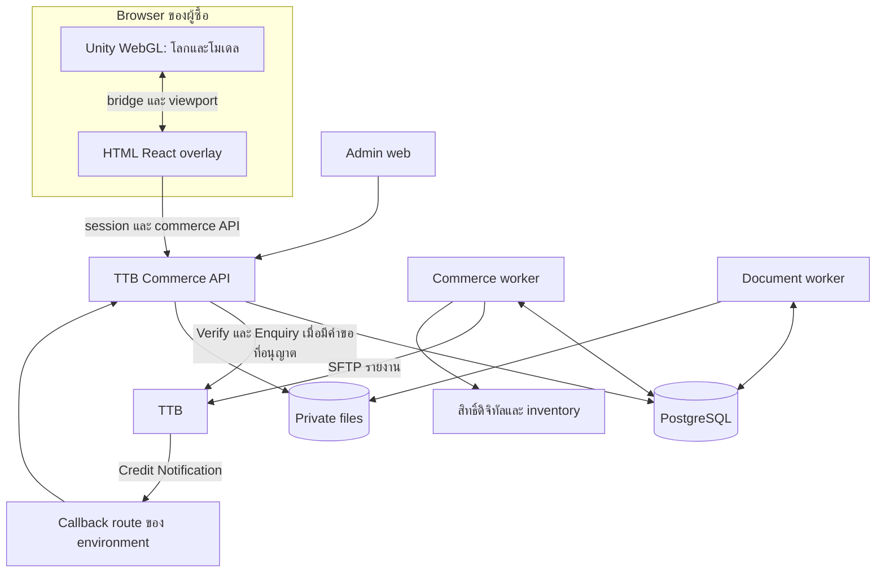

# แผนพัฒนาระบบซื้อสินค้าในเมตาเวิร์สผ่าน TTB QR

วันที่จัดทำ: 18 ตุลาคม 2026 (Asia/Bangkok)

สถานะ: แผนสำหรับตรวจทานก่อนเริ่มพัฒนา เอกสารนี้ไม่ได้เป็นผลทดสอบ API ธนาคาร ไม่ได้ deploy และไม่ได้เปลี่ยนบริการ KKU

ใช้คู่กับ [บัญชีความสามารถ TTB API และประเด็นค้าง](<C:/CosmoPC/Work/Unity/MANGOxTTB/Documentation/TTB_API_CAPABILITIES_TH.md>) ซึ่งระบุ endpoint, request/response, รหัสผลลัพธ์ และหน้าอ้างอิงของสเปก

## 1. ขอบเขตที่ผู้ใช้ยืนยันแล้ว

| เรื่อง | ข้อกำหนด |
|---|---|
| ผู้ขาย | บริษัท/ร้านค้าเดียว รับเงินเข้าบัญชีบริษัทเดียว |
| สินค้า | มีทั้งสินค้าจริงและสินค้าดิจิทัล หลาย SKU/ตัวเลือก |
| หน้าร้าน | โมเดล 3D ใน Unity WebGL; คลิกแล้วเปิด HTML overlay |
| UI | หมุน/ซูมโมเดล เลือกสินค้า ตะกร้า checkout QR ใบเสร็จและประวัติ อยู่นอก Unity UI |
| การชำระ | Backend สร้าง Dynamic QR ระบุยอดและหมดอายุ; TTB ยืนยันเงิน |
| หลักฐานให้ผู้ซื้อ | PDF ใบเสร็จที่บันทึกและสั่งพิมพ์ได้ ดาวน์โหลดซ้ำจากประวัติ |
| บัญชีผู้ใช้ | ยึด MANGOs identity ที่ Backend ตรวจสอบได้ ไม่ใช้ชื่อ guest เป็นเจ้าของรายการ |
| UAT callback host | ttb-api-test.mangosgo.com |
| Production callback host | ttb-api.mangosgo.com |
| เครื่องหลังบ้าน | ntserver02 / 209.15.122.115 |
| ตัวอย่างเทคนิค | https://plus.mangosgo.com/systemtester/ และบริการ KKU commerce ที่อยู่บน ntserver02 |

หนึ่งออเดอร์รวมสินค้าจริงและดิจิทัลได้ ชำระยอดรวมด้วย QR เดียว แต่ติดตามการส่งมอบแยกรายการ. หนึ่ง Biller ต่อ environment เพียงพอสำหรับผู้ขายเดียว ไม่ต้องสร้าง Sub-biller ต่อสินค้า. ค่า Biller ของ UAT/Prod ต้องใช้ตาม provisioning จริง ไม่สมมติว่าต่างกันหรือเหมือนกัน

ข้อเสนอ baseline ที่ต้องยืนยันใน P0: THB สองตำแหน่ง, ต้อง login ก่อนเพิ่มตะกร้า/checkout ตามตัวอย่างเดิม, จัดส่ง/รับสินค้าโดยผู้ขายผ่าน admin ก่อนเชื่อม carrier API, ใบเสร็จรับเงินบริษัทเป็นเอกสารหลัก. ใบกำกับภาษี/e-Tax, email/SMS, marketplace หลายผู้ขาย, wallet, subscription และระบบขนส่งภายนอกเป็นขอบเขตเพิ่มเติมเมื่อระบุ requirement

## 2. สิ่งที่ตรวจพบในระบบเดิมและผลต่อแผน

ตรวจแบบ read-only ผ่าน SSH และ browser ในการสนทนานี้ รวมถึงตรวจซ้ำโครงสร้าง deployment วันที่ 18 ตุลาคม 2026 โดยไม่อ่านค่าลับหรือข้อมูลคำสั่งซื้อของลูกค้า

| หลักฐานที่พบ | ผลต่อการออกแบบ |
|---|---|
| ntserver02 ใช้ k3s, ingress-nginx, cert-manager | ใช้โครงสร้างนี้ต่อและสร้าง namespace/config ของ TTB แยก |
| kku-commerce-api และ kku-commerce-db อยู่ namespace mangos | ใช้เป็นแบบอ้างอิง ไม่ชี้ TTB เข้าฐานข้อมูล KKU |
| KKU API เป็น ASP.NET Core net10.0; DB PostgreSQL 18 | เสนอ stack เดียวกัน ลดรูปแบบ infrastructure ที่ต้องดูแล |
| Route เดิม plus.mangosgo.com/commerce/v1 | จอง prefix TTB ใหม่ ไม่ทับ route นี้ |
| มี Products, Carts, CartLines, Quotes, Orders, Attempts, Receipts, Audit | ใช้รูปแบบ domain เดิมได้ แต่เพิ่ม bank evidence, inventory, digital fulfillment และ reconciliation |
| มี IPaymentProvider, PaymentWorker, ReceiptWorker, HtmlReceiptRenderer | เป็นแนวคิด reuse; TTB ต้องเปลี่ยนจาก polling provider เป็น webhook-first และ local QR generation |
| Frontend เป็น HTML/React bundle และ bridge ไป Unity | ยึดเทคนิค overlay/viewport เดิม |
| หมุนและซูมโมเดลจาก HTML ทำงานใน browser ที่ตรวจ | ใช้เป็น interaction reference; สินค้าที่เปิดตรวจยังแสดง cube จึงต้องผูกโมเดลจริงเพิ่ม |
| ประวัติ/ตะกร้าใน guest ขอ login MANGOs | สอดคล้องกับข้อเสนอ ownership ของระบบใหม่ |
| Published release ที่ตรวจไม่มี .cs/.csproj/.ts/.tsx/.map ของแอป | ต้องหาต้นฉบับ repository และ build process ก่อนสัญญาว่าคัดลอกแก้โมดูลเดิมได้ |
| ยังไม่พบ ingress/certificate ของสอง hostname TTB ในรายการที่ตรวจ | วางแผนสร้าง route/TLS ภายหลัง ไม่ถือว่าเปิดพอร์ตแล้วเท่ากับ deploy เสร็จ |
| Project Unity ปัจจุบันมี voice overlay แต่ไม่พบ commerce bridge จากการค้น targeted source | ต้องทำ integration ของ TTB ใน project นี้ ไม่ถือว่าหน้า systemtester มีอะไรแล้วจะอยู่ใน project นี้อัตโนมัติ |
| WebGL template ปัจจุบัน reload เมื่อ service-worker เปลี่ยน controller | ต้องเพิ่ม update policy ที่ไม่ตัด checkout กลางทาง |

พบ CPU/หน่วยความจำและ disk ที่ยังเหลือจาก snapshot เดียว แต่ยังไม่ใช่ผล capacity test. หนึ่งเครื่องยังเป็นจุดล่มร่วมของ UAT, Production, Unity และ DB; การแยก namespace ไม่ทำให้เป็น HA

ยังไม่ได้ทำ checkout หรือชำระเงินจริงในระบบ KKU ไม่ได้ทดสอบ session ของบัญชี production และไม่ได้ทดสอบ callback จาก TTB

## 3. สถาปัตยกรรมที่เสนอ

ใช้ ASP.NET Core แบบแยกโมดูลภายในแอปเดียวสำหรับ Catalog, Cart, Orders, Payments, Fulfillment, Documents และ Admin. ใช้ PostgreSQL สำหรับข้อมูลถาวรและคิวงานแบบ durable outbox. แยกการรับ HTTP, งานทั่วไป และงานสร้าง PDF เป็น deployment roles เพื่อจำกัดทรัพยากรและความเสียหายเมื่อ worker ล้ม

ไม่จำเป็นต้องเพิ่ม Redis หรือ message broker ใน baseline; คิว DB ต้องมี lease, retry, idempotency และ recovery ที่ทดสอบได้. เพิ่มระบบคิวเฉพาะเมื่อ load test หรือ integration ที่ตกลงแสดงว่าจำเป็น

ลูกศรไป TTB ของ worker หมายถึง SFTP และงานที่มี policy ระบุ ไม่ใช่ background Verify ทุกออเดอร์เป็น interval

### 3.1 การแบ่ง route

| ช่องทาง | ข้อเสนอ | ผู้เรียกและการคุ้มครอง |
|---|---|---|
| Shopper API Production | origin เดียวกับ portal TTB + /ttb-commerce/v1 | Browser/MANGOs session, ownership, CSRF สำหรับ cookie auth |
| Shopper API UAT | portal UAT หรือ /ttb-commerce-test/v1 บน origin ที่ตกลง | บัญชีทดสอบ session/cookie แยก scope |
| Callback UAT | ttb-api-test.mangosgo.com/ttb/v1/credit-notification | ธนาคาร; auth และ source IP ตามข้อตกลง |
| Callback Production | ttb-api.mangosgo.com/ttb/v1/credit-notification | ธนาคาร; ห้ามใช้ credential หรือ DB UAT |
| Admin | ภายใต้ API ของ environment พร้อม policy แยก | Catalog admin, fulfillment operator, finance operator |
| Health | ภายใน cluster/monitoring | แยก liveness, readiness, payment dependency status |

ชื่อ path ใหม่ทั้งหมดเป็นข้อเสนอ ต้องล็อกใน P0 ก่อน implementation. ให้บริการภายในต่าง namespace ผ่าน route ที่ตั้งใจเท่านั้น; ถ้า ingress อยู่คนละ namespace ใช้ ingress ตาม namespace ของ service และ TLS ที่จัดการอย่างถูกต้อง

### 3.2 บริการบน ntserver02 ต่อ environment

| Resource | หน้าที่ |
|---|---|
| Namespace ttb-uat / ttb-prod | แยก config, network policy, service account, PVC และ secrets |
| ttb-commerce-api | Shopper/admin API และ callback handler ที่ commit สั้น |
| ttb-commerce-worker | Outbox fulfillment, inventory expiry, reconciliation/report ingest, งานปฏิบัติการที่ retry ได้ |
| ttb-document-worker | ใบเสร็จและ Void slip ผ่าน HTML-to-PDF โดยไม่แย่งงาน HTTP |
| PostgreSQL + private service + PVC | เงิน ออเดอร์ สิทธิ์ งานค้าง และ audit; ไม่เปิด DB สู่ public |
| Private storage/PVC | ใบเสร็จ, encrypted report archive และ evidence ที่ต้องเก็บ |
| Ingress/TLS | สอง hostname callback และ Shopper API ตาม route plan |
| Backup + monitoring | DB/PITR หรือแผนที่ผ่าน restore drill, private files, key recovery และ alert |

เริ่ม API หนึ่ง replica และ worker/PDF อย่างละหนึ่งได้ แต่ข้อมูลเงินและคิวต้องรองรับการมีหลาย replica ตั้งแต่ต้น. Initial resource requests/limits ต้องกำหนดหลัง baseline measurement โดยแยก PDF memory/browser concurrency ออกจาก callback. ไม่ copy ค่า limits ของ KKU โดยถือว่าเพียงพอทันที

## 4. ข้อกำหนดที่ใช้ตรวจรับ

| ID | Requirement | เกณฑ์รับหลัก |
|---|---|---|
| R01 | คลิกโมเดลเปิดสินค้า | ProductId ตรง catalog; ไม่เชื่อราคา/ชื่อจาก Unity |
| R02 | หมุน ซูม reset | mouse/touch/pinch/wheel ทำงานและไม่บังคับตัวละคร |
| R03 | Catalog/variants | สินค้า draft ไม่ checkout; SKU/model mapping ชัด |
| R04 | MANGOs login | Backend ยืนยัน identity; แยกข้อมูลเมื่อเปลี่ยนบัญชี |
| R05 | Cart | เก็บบน server; ป้องกัน lost update หลายแท็บ |
| R06 | Quote | Backend คำนวณและมี version/expiry; ราคาเปลี่ยนต้องรับทราบก่อนซื้อ |
| R07 | Mixed order | Physical+Digital ยอดรวมเดียว สถานะส่งมอบแยกรายการ |
| R08 | Stock reservation | คำสั่งซื้อพร้อมกันไม่ขายเกิน; expire/release มีหลักฐาน |
| R09 | Dynamic QR | payload/CRC/amount/expiry/QRId ถูกต้องและไม่ซ้ำ |
| R10 | Callback | ตรวจ key และบันทึกถาวรก่อน ACK; เงิน/งานส่งมอบไม่ซ้ำ |
| R11 | Verify/Enquiry | ใช้เมื่อจำเป็น มี budget ต่อ attempt รวมทั้งสองบริการ และไม่ยิงจาก GET สถานะ |
| R12 | Late/extra/mismatch payment | เก็บเงินที่พบและเปิด case; ไม่ทิ้งหรือคืนเงินโดยสมมติ |
| R13 | Digital entitlement | ให้สิทธิ์เฉพาะ paid allocation ที่อนุมัติ และให้ซ้ำไม่ได้ |
| R14 | Physical fulfillment | จัดเตรียม/ส่ง/รับ/เสร็จสิ้นแยกจากสถานะชำระ |
| R15 | Receipt PDF | snapshot คงเดิม เลขเอกสารไม่เปลี่ยนเมื่อ download ซ้ำ |
| R16 | History | ใช้งานได้หลัง reload/เปลี่ยนเครื่อง; เฉพาะเจ้าของ |
| R17 | Admin | แบ่งสิทธิ์และ audit การแก้ไข/คืนเงิน |
| R18 | SFTP/PGP | ตรวจ host key, decrypt, parse/version, totals และ ingest ซ้ำได้ |
| R19 | Reconciliation | ตรวจ callback หาย Void และ LOST โดยไม่ grant ซ้ำ |
| R20 | Void | eligibility, transaction ID, unknown outcome และ Void slip |
| R21 | Cross-border | field/currency semantics และ refund policy ผ่าน UAT ก่อนเปิด |
| R22 | Environment isolation | UAT event ไม่แก้ Prod แม้ IDs/จำนวนเงินตรงกัน |
| R23 | Cache/update recovery | ไม่ cache private API; เปลี่ยน build/close tab ไม่สร้าง order/QR ใหม่เอง |
| R24 | Backup/operations | restore drill และปฏิบัติการช่วง bank/DB ล่มผ่าน |
| R25 | Security | CSRF, ownership, role, session, no secrets ใน browser และ rate limit ผ่าน |
| R26 | Accessibility/device | keyboard/focus, desktop/mobile, viewport/fullscreen/orientation ผ่าน |

## 5. แบบข้อมูลที่เสนอ

ชื่อด้านล่างเป็น logical entities; schema จริงกำหนด migration หลัง P0 และไม่รวมกับตาราง KKU. ใช้ integer minor units สำหรับ THB, checked arithmetic, stable opaque IDs, UTC timestamps และ business date Asia/Bangkok ที่แยกต่างหาก. เก็บ bank identifiers และ raw date strings โดยไม่ตัดข้อมูล

| Entity/กลุ่มข้อมูล | ข้อมูลหลักและข้อจำกัด |
|---|---|
| MerchantSettings | company receipt profile, currency, environment, Biller/Merchant ID; secrets อ้างจาก secret store |
| UserMapping / Sessions | trusted issuer+subject → internal owner, role, session expiry |
| Products / Variants | SKU, type Physical/Digital, price, publication, options, tax classification ที่บริษัทกำหนด |
| ProductAssets | asset ID/URL/version, thumbnail, preview mapping และ settings มุม/scale; ไม่รวมสิทธิ์ซื้อไฟล์จริง |
| Carts / CartLines | owner, versions, SKU/variant/quantity; ไม่เป็นหลักฐานราคาถาวร |
| Quotes | cart version, authoritative line snapshot, shipping, total, expiry และ buyer/delivery snapshot |
| Orders / OrderLines | immutable purchase snapshot, order number, owner, currency, totals, quote reference และ lifecycle |
| Inventory / Reservations | available/reserved/committed ตาม SKU/variant, order line, expiration และ movement history |
| PaymentAttempts | order, QRId, payload/hash, refs, expected amount, issued/expires timestamps, generation/profile version |
| CallbackReceipts / PaymentObservations | source, raw evidence reference/hash, received time, request UID, normalized outcome และ notification ACK history |
| BankTransactions | InstructionId, Biller, QRId, actual amount, payer fields ที่มี, cross-border metadata, original instruction relation และ bank time พร้อมความหมาย/แหล่งที่มา |
| PaymentAllocations | จับคู่ credit transaction กับ order; unique allocation ของ transaction และกติกา primary payment ต่อ order |
| VerificationRequests | actor, reason, attempt, requested time, result, budget/cooldown และ single-flight lock |
| FulfillmentItems / Jobs | order line, kind, quantity, state, attempt/retry, business error และ external action id |
| Entitlements / DigitalDeliveries | owner, product/asset/version, order line, quantity/units, grant/revoke evidence และ download policy |
| Shipments / Pickup | physical lines, delivery snapshot, tracking/pickup record และ operator actions |
| Documents | receipt/Void slip, number, immutable snapshot, file reference/hash, generation state และ relation เอกสารเดิม |
| RefundCases / VoidRequests | เหตุผล รายการเงินเป้าหมาย amount ที่ร้องขอ eligibility, bank request/response, unknown state และเอกสาร |
| ReportFiles / ReportRows | encrypted/decrypted evidence refs, hashes, layout version, bank business date, row identity และ totals |
| ReconciliationCases | missing/mismatch/extra/void/conflict, evidence, assignee, resolution และ audit |
| OutboxJobs / AuditEvents | durable work, idempotency key, lease, retry/next attempt, actor และ correlation |

ข้อกำหนด unique/transaction สำคัญ:

1. QRId ไม่ซ้ำภายใน environment/Merchant ตลอดประวัติที่เก็บ ไม่พึ่งการล้างข้อมูลของธนาคาร
2. Bank credit transaction ใช้ unique environment+Merchant/Biller scope+InstructionId; observation หลายแหล่งแนบ transaction เดิมได้
3. Notification ACK แยกจากการรู้ผลเงินด้วย Verify เพื่อให้ตอบ callback แรก/ซ้ำถูกต้อง
4. Order creation ใช้ owner+idempotency key พร้อม request hash; key เดิมข้อมูลต่างกันต้อง conflict
5. มี active QR attempt ที่ยังไม่หมดอายุต่อ order ได้หนึ่งรายการ; ขอซ้ำคืน payload เดิม
6. ข้อจำกัด allocation + order lock ป้องกัน credit สองรายการเปิดการส่งมอบสองรอบ; เงินเกินยังต้องเก็บ BankTransaction และ case
7. Digital fulfillment idempotency ตาม order line และหน่วย/quantity ที่ซื้อ ไม่ใช่ product+owner ซึ่งอาจซื้อเพิ่มได้จริง
8. Document number และ outbox effect key ไม่ซ้ำ; reprint ไม่เพิ่มเลขเอกสาร
9. Reservation/commit/release ใช้ DB transaction และ conditional update ไม่เชื่อ stock จาก browser
10. Report debit/void เก็บ OriginalInstructionId และ movement ต่างหาก ไม่ใช้ V/D เป็นการหักเงินซ้ำโดยอัตโนมัติ

## 6. สถานะและกติกาการเปลี่ยนสถานะ

แยกสถานะออเดอร์ ผลเงิน การส่งมอบ และเอกสาร เพื่อให้ worker ล้มแล้วไม่ย้อนสถานะเงิน

| กลุ่ม | สถานะตัวอย่างสำหรับกำหนด contract |
|---|---|
| Order | Open, CancelRequested, Cancelled, Completed, Review |
| Payment attempt | AwaitingPayment, Expired, Replaced, Confirmed, Review |
| Payment summary | Unpaid, Paid, Review, VoidPending, Voided; มีตัวเลข received/allocated/refunded แยก |
| Void request | Requested, Submitted, Confirmed, Rejected, Unknown, ManualResolution |
| Digital line | Pending, Granting, Delivered, RetryPending, Review, Revoked เมื่อมี policy รองรับ |
| Physical line/group | Reserved, Preparing, ReadyForPickup, Shipped, Delivered, Cancelled, Review |
| Document | Pending, Generating, Ready, RetryPending, Review; เอกสารเดิมคงเก็บเมื่อมี Void slip |

กติกาที่ห้ามละเมิด:

- แยกเวลาที่ระบบยืนยันเงิน, เวลาที่รับ notification, TransDate ดิบ และเวลาชำระต้นทางที่ทราบจริง. Verify response อาจให้ system time จึงไม่ใช้แทนเวลาชำระเดิมเพื่อขยายช่วง Void หรือเลือกวันบัญชี หากไม่มีหลักฐานยืนยัน
- Timeout/no-data/expiry ของหน้าเว็บ ไม่แปลว่าไม่มีเงินเข้าแน่นอน และไม่ย้อน Paid เป็น Unpaid
- Report/Verify ที่ไม่มีข้อมูลหรือเก่ากว่า ไม่ลบผลรับเงินที่เคยยืนยัน; ข้อมูล Void ที่มีหลักฐานจริงเปลี่ยนผลตาม reducer และ audit
- การสร้าง PDF ล้มไม่เปลี่ยน Paid และไม่ให้ผู้ใช้ชำระใหม่
- Cancel ก่อนจ่ายคือหยุด order flow ภายใน ไม่ใช่ bank refund หรือ revoke QR
- เงินเข้าหลัง cancel/expiry และสินค้าไม่มีแล้วต้อง Review/RefundCase; ไม่ส่งสินค้าหรือให้สิทธิ์โดยไม่ตรวจเงื่อนไข
- การเปิด QR ใหม่ต้องเก็บ QR เก่าตลอดเพื่อจับ late payment ไม่ลบทิ้ง
- เงินรายการที่สองซึ่งมี InstructionId ใหม่เป็นเงินเพิ่ม ไม่ใช่ notification duplicate 0004; เก็บและตรวจคืน/จัดสรรอย่างถูกต้อง
- Void ของเงินส่วนเกินต้องไม่ยกเลิก primary payment ของ order ที่ชำระถูกต้องแล้ว
- Full Void ของ primary payment ต้องประสาน fulfillment และเอกสารตามนโยบายบริษัท ไม่ลบประวัติการส่งมอบ
- Worker ที่รับ Paid event ค้างอยู่ต้องตรวจ allocation/สถานะเงินและ policy ล่าสุดก่อน grant หรือส่งสินค้า; ถ้ามี Void/Review แทรกมาให้หยุด effect ที่ยังไม่เกิด และเปิด recovery สำหรับ effect ที่เกิดไปแล้ว

## 7. เส้นทาง checkout แบบละเอียด

1. Unity ส่งเฉพาะ ProductId/interaction context ให้ overlay. Overlay อ่านข้อมูลปัจจุบันจาก Catalog API
2. ผู้ใช้ login MANGOs ก่อนเพิ่มสินค้า; Backend ยืนยันผ่าน integration เดิมที่เชื่อถือได้และออก commerce session ของ environment
3. เพิ่ม/แก้ cart ด้วย version; API ตรวจ SKU, publication, variant และจำนวน
4. Checkout ขอ Quote: อ่านราคา/stock ฝั่ง server, คิดยอดและค่าจัดส่งเฉพาะ physical, เก็บ snapshot และ expiry
5. ถ้ามี physical shipping เก็บที่อยู่/ติดต่อ; pickup ไม่บังคับ shipping address; digital-only ไม่บังคับข้อมูลขนส่ง
6. ผู้ใช้ยืนยัน Quote; API สร้าง Order, reserve stock, สร้าง payment attempt + QR payload ภายใน transaction ที่ retry แบบ idempotent ได้
7. TTL เริ่มต้นเสนอ 10 นาที ปรับได้ใน config ให้ตรง inventory reservation/expiry ระดับนาทีและช่วง purge ของ TTB; ต้องระบุ expiresAt จริงให้ UI ไม่คำนวณใหม่เอง
8. UI แสดงชื่อผู้รับที่บริษัท/ธนาคารรับรอง ยอด THB เลขออเดอร์ expiry วิธีสแกน/บันทึก QR และสถานะรอเงิน
9. Browser อ่านสถานะของ Backend ประมาณทุก 2–3 วินาทีเฉพาะหน้าที่เปิด หรือใช้ event channel ที่ยืนยันสิทธิ์ได้; GET นี้ไม่เรียก TTB
10. TTB callback → ตรวจ/auth/จับคู่ → durable commit → ACK → outbox ส่งงานต่อ
11. เมื่อรอประมาณ 60 วินาทีโดยยังไม่พบ notification เปิดให้ผู้ใช้/finance operator ขอ Verify; รวม budget Verify+Enquiry ต่อ attempt ไม่เกิน 3 ครั้งตามข้อเสนอที่ระมัดระวัง ใช้ cooldown และ single-flight; การเปลี่ยนแท็บ/ผู้กดไม่ reset budget
12. หลัง Paid งานดิจิทัล, งานสินค้าจริง และใบเสร็จเริ่มได้โดยอิสระ; UI แสดงผลรายรายการและสถานะเอกสาร
13. Reload/ออกจากโลก/เปลี่ยนเครื่องแล้ว login กลับมา อ่าน order เดิมจากประวัติ; ไม่สร้าง payment attempt ใหม่เพียงเพราะหน้าโหลดใหม่
14. หากหมดอายุแล้วต้องการจ่ายต่อ ขอ attempt ใหม่อย่างมีเงื่อนไข ตรวจเงิน/stock/ราคาและข้อผูกพันเดิมก่อน ถ้าต้องเปลี่ยนราคาต้องขอความยินยอมและ Quote ใหม่อย่างชัดเจน

หากเกิด network uncertainty ไม่ควรบังคับให้ผู้ซื้อจ่ายซ้ำ. แสดง “กำลังตรวจสอบการชำระเงิน” พร้อมสถานะและเลขออเดอร์ที่ติดตามได้

เพิ่ม rate limit และ bank-request budget รวมต่อ owner/order/Merchant/environment เพื่อไม่ให้การสร้าง attempt ใหม่หรือหลายบัญชีเลี่ยงข้อจำกัด. ตัวเลขรวมต้องตกลงตามความจุและข้อกำหนดธนาคาร; load test ของระบบเราต้องใช้ bank mock ไม่สร้างโหลด Verify จริงโดยไม่ตกลง

## 8. การรับเงินและ recovery

### 8.1 Callback transaction

1. Ingress ตรวจ host/path และ bank authentication ที่ตกลง พร้อม trusted source-IP handling และ request limits
2. Normalize โดยรักษา raw identifiers; parse amount/date แบบเคร่งครัด ไม่ใช้การเติม/ตัดข้อมูลเพื่อให้จับคู่ได้
3. ตรวจ environment, Biller, QRId, refs, amount และ ResultCode ตาม service profile
4. ตรวจ notification receipt และ BankTransaction ภายใต้ unique constraints/locks
5. ถ้าข้อมูลถูกต้อง บันทึก observation, bank transaction, allocation, payment state และ outbox ใน transaction เดียว
6. ตอบ response ตาม TTB contract เมื่อ commit สำเร็จ; ไม่รอ PDF/ขนส่ง/Unity server
7. ถ้ารายการเคย ACK แล้ว ตอบ 0004 และไม่ทำ business effect ซ้ำ; same ID แต่ข้อมูลเปลี่ยนส่ง investigation
8. ถ้าบันทึกไม่ได้ ห้ามตอบ success. ใช้ failure response ที่ตกลงและ alert; เอกสารรับรอง retry เฉพาะ timeout จึงต้องมีรายงานกู้รายการด้วย ไม่พึ่งว่า 9999 จะถูก retry เสมอ

เป้าหมายภายในเริ่มต้น: callback handler p95 ไม่เกิน 1 วินาทีในสภาพ load ที่ตกลง ไม่ใช่ค่า timeout ที่ธนาคารรับรอง. ต้องวัดจริงและปรับตาม bank SLA

### 8.2 เส้นทางเงินที่ต้องตรวจทุกกรณี

| เหตุการณ์ | ผลระบบ |
|---|---|
| Callback และ Verify มาพร้อมกัน | หนึ่ง allocation และหนึ่งชุด outbox; เก็บ evidence ทั้งคู่ |
| Worker ล้มหลัง commit | งานค้างฟื้นจาก durable outbox ไม่มีเงินหรือสินค้าเพิ่มซ้ำ |
| ACK สูญหาย | ธนาคาร retry; duplicate handler ตอบถูกต้อง |
| Payment amount/refs ไม่ตรง | เก็บ observation/case และ response mismatch ตามสเปก; ไม่ถือว่าเงินถูกคืนแล้ว |
| ไม่รู้จัก QRId | จัดเก็บในช่องทาง quarantine หลัง auth ผ่าน; ไม่จับคู่จากยอดเงินหรือชื่อผู้จ่าย |
| สอง order ยอดเท่ากัน | จับด้วย QRId/refs ไม่ใช้ยอดและเวลาเพียงอย่างเดียว |
| เงินเข้าหลัง stock release | ยืนยันว่าพบเงินแต่ตรวจส่งมอบ/คืนเงินผ่าน case |
| Verify ไม่พบ | คง unconfirmed; bounded manual recheck/report recovery |
| Bank/DB ขัดข้อง | ปิดสร้าง QR ใหม่เมื่อรับเงินอย่างปลอดภัยไม่ได้; order เดิมยังมีประวัติและ recovery |
| มีสอง bank credits ของ order เดียว | บันทึกทั้งสอง เปิด extra-payment case ไม่ grant ซ้ำ |

## 9. สินค้าจริงและสินค้าดิจิทัล

Physical: กำหนด stock tracking ต่อ SKU/variant, reservation ที่สร้างพร้อม order, committed stock หลัง paid, กติกาปล่อยเมื่อ expiry/cancel และวิธีจัดการ late payment. ผู้ดูแลปรับสถานะจัดเตรียม/ส่ง/รับสินค้าได้ตามสิทธิ์พร้อม audit. ไม่เชื่อ stock จาก client และไม่หักซ้ำเมื่อ callback/worker retry

Digital: SKU ต้องระบุ fulfillment kind เช่น entitlement, inventory item หรือ download และตัวรับงานที่เชื่อถือได้. Grant หลังยืนยัน allocation และผ่าน business policy เท่านั้น. ถ้าเป็นไอเทมในโลก ให้ backend/Unity dedicated server ตรวจสิทธิ์กับข้อมูลจริงก่อนใช้ ไม่รับข้อความ Paid จาก browser เป็นสิทธิ์. Grant/revoke ต้องมี operation ID ที่ replay ได้โดยไม่ซ้ำ

ถ้าขายไฟล์ GLB/asset เอง ให้ preview ใช้ไฟล์ที่เหมาะกับการเปิดเผย ส่วนไฟล์เต็มอยู่ private storage และให้ดาวน์โหลดตามสิทธิ์/URL อายุสั้น. ไม่ใช้การซ่อนปุ่มเป็นการคุ้มครองไฟล์

Mixed order: ใช้ fulfillment items ต่อ line หรือกลุ่มที่ชัดเจน. ส่งมอบดิจิทัลสำเร็จแล้วไม่ทำให้ทั้ง order แสดงว่าสินค้าจริงส่งแล้ว. ออเดอร์เดียวมี shipment/pickup และ digital delivery หลายงานได้

นโยบายคืนสินค้าจริง/เพิกถอนสิทธิ์ดิจิทัล/สินค้าที่ใช้ไปแล้วต้องกำหนดกับบริษัทก่อนเปิดปุ่มคืนเงิน การมี API Void ไม่ได้ตัดสินเงื่อนไขทางธุรกิจแทนเรา

## 10. ใบเสร็จ การพิมพ์ และประวัติ

TTB ชุดนี้ไม่มี API ออกใบเสร็จรายการสินค้าของบริษัท. ใช้ Document service ของเรา สร้างจาก paid allocation และ order snapshot: ผู้ออกเอกสาร เลขเอกสาร วันที่ รายการ/ตัวเลือก/จำนวน ราคา ยอดรวม/ค่าจัดส่ง รายละเอียดภาษีตามที่บริษัทกำหนด และอ้างอิงการรับเงินที่จำเป็น

- เก็บ snapshot, template version, file hash, issue time และหมายเลขคงเดิม
- Retry generation และ reprint ไม่ออกเลขใบเสร็จใหม่; ไม่ส่งข้อมูลมูลค่าจาก browser มาสร้างเอกสารโดยตรง
- Browser มี Download PDF และเปิดฉบับสำหรับ Print/Save PDF; mobile ทดสอบไฟล์ภาษาไทยและวิธี save จริง
- เมื่อ Void สำเร็จเก็บเอกสารเดิมและออก Void slip ที่เชื่อมกัน ไม่ลบหรือแก้หลักฐานเดิมเงียบ ๆ
- Private file download ต้องตรวจ owner/finance role ทุกครั้ง. Signed URL ถ้าใช้ต้องจำกัดอายุและขอบเขต
- UI แสดง “กำลังจัดทำใบเสร็จ” และ retry ได้เมื่อ PDF worker มีปัญหา โดยสถานะเงินยัง Paid
- ใบกำกับภาษี/e-Tax เป็น document requirement เพิ่มที่ต้องได้รูปแบบและข้อมูลจากฝ่ายบัญชี ไม่อ้างว่า payment slip ของธนาคารใช้แทนได้

ประวัติผู้ซื้อแสดง order number/date, items, total THB, payment status, สถานะส่งมอบรายรายการ, receipt/Void slip และเหตุการณ์ที่ผู้ซื้อควรรู้. มี pagination/filter และ order details. ค้นด้วย trusted user ID ไม่ใช้ nickname, email ที่ browser ส่งเอง หรือ localStorage เป็นฐานข้อมูลหลัก

## 11. HTML overlay และ Unity bridge

ยึด systemtester: HTML/React จัด UI และ pointer controls; Unity วาดโมเดลด้วย preview camera ตาม normalized viewport ของช่อง HTML. ไม่เพิ่ม WebGL engine อีกตัวใน baseline. หากไม่พบโมเดล แสดง fallback พร้อมสถานะ ไม่ใช้ cube แทนสินค้าโดยไม่บอก

หน้าที่ต้องมี: Catalog/search, Product/variants/quantity, Cart, Checkout/review quote, QR payment, Payment result, Order history/detail, Receipt/print, Digital library/download และ admin แยกสิทธิ์

| ทิศทาง | Event ตัวอย่าง | Contract สำคัญ |
|---|---|---|
| Unity → HTML | host.ready, product.open, preview.ready/error, session.end | version, correlation/request ID, productId; ไม่ใส่ราคาเป็น authoritative |
| HTML → Unity | web.ready, product.inspect, preview.viewport, preview.orbit/zoom/reset | validation ขนาด/ค่าพิกัด; preview จัดแสดงเฉพาะผู้ใช้ ไม่ synchronize การหมุนไปทั้งห้อง |
| HTML → Unity | overlay.state, overlay.close | ระงับ movement/look/input ที่เกี่ยวข้องและคืนค่าทุกเส้นทาง |
| Trusted backend → game integration | entitlement changed / ตรวจสิทธิ์ | event ฝั่ง browser เป็นเพียงแจ้ง refresh; สิทธิ์จริงตรวจ server |

รายละเอียด interaction: pointer capture สำหรับ drag, pinch สองนิ้ว, clamp pitch/zoom, reset, viewport เมื่อ scroll/resize/เปลี่ยน orientation, retina scaling, fullscreen ที่รวม HTML root, focus trap/Escape, คืน focus และ input เมื่อตาย/เปลี่ยนโลก/ปิด overlay/เกิด error. เคารพ orientation guard ของ project และทดสอบไม่ชน voice overlay

บัญชีเปลี่ยนต้อง cancel request เก่า ล้าง state รายบุคคลและเปิด session ใหม่; response ช้าของบัญชีเก่าห้ามทับ UI บัญชีใหม่. ปุ่ม confirm ป้องกัน double click แต่ความถูกต้องต้องมี server idempotency ด้วย

QR ต้องคม ไม่บิด perspective มี quiet zone และใช้โลโก้ตาม S1 หน้า 31–34/asset ที่ธนาคารรับรอง. Cross-border logo asset ชุดแยกไม่ได้อยู่ในโฟลเดอร์ที่ตรวจ ต้องขอฉบับใช้งานจริงถ้าจะเปิดแสดง. ทดสอบสแกนจากหลายธนาคาร/จอ/ขนาด ไม่ถือว่า CRC ผ่านแปลว่าสแกนจ่ายได้ทุกแอป

ผู้ใช้โทรศัพท์เครื่องเดียวต้องมี Save QR/คำแนะนำการนำเข้ารูปตามแอปที่ทดสอบแล้ว หรือสแกนจากอีกอุปกรณ์. ไม่สมมติว่ามี TTB deep-link หรือ auto-open bank app เพราะไม่มี contract ในเอกสารนี้

PWA ต้อง bypass cache สำหรับ session/cart/quote/order/QR/receipt/entitlement. ตั้ง private response เป็น no-store และ cache เฉพาะ immutable public assets. ระงับ auto reload ระหว่าง checkout; แจ้งว่ามีอัปเดตและคืน order เดิมหลัง refresh. ไม่เปลี่ยนระบบ voice/avatar/controller เดิมนอกจุด integration ที่จำเป็น

## 12. API ภายในที่เสนอ

ทั้งหมดต่อจาก Shopper API prefix ของ environment ใน §3.1 ไม่ใช่ endpoint ที่ TTB กำหนด. Pagination, error schema, request UID, version และ ownership เป็นมาตรฐานร่วม. Mutation ผ่าน cookie session ต้องตรวจ CSRF และ origin

| Method/route | หน้าที่และเงื่อนไข |
|---|---|
| POST /session/bootstrap; GET /me; POST /session/logout | ยืนยัน MANGOs session, identity/role และออกจาก commerce session |
| GET /catalog/products; GET /catalog/products/{id} | สินค้าที่เปิดขายและ model metadata ตามสิทธิ์ |
| GET /cart | อ่าน cart/version ของตน |
| POST /cart/lines; PATCH/DELETE /cart/lines/{id} | ตรวจ expectedVersion และ stock policy |
| POST /checkout/quote | คำนวณยอดและจัดส่งพร้อม snapshot/expiry |
| POST /orders | ใช้ quoteId + Idempotency-Key สร้าง order/reservation/attempt |
| GET /orders; GET /orders/{id} | ประวัติและสถานะจาก DB เท่านั้น |
| GET /orders/{id}/qr | คืน QR ของ attempt ที่อนุญาต ไม่สร้าง attempt ใหม่ผ่าน GET |
| POST /orders/{id}/payment-attempts | ขอ QR ใหม่เมื่อเข้าเงื่อนไข มี idempotency และเก็บ attempts เก่า |
| POST /orders/{id}/verify | manual ตรวจผลพร้อม cooldown/budget/single-flight ไม่ให้ client ส่ง Biller/QRId ของผู้อื่น |
| POST /orders/{id}/cancel | ขอ cancel ภายใน ระบุผลต่างเมื่อ paid/review/late payment |
| GET /receipts/{id}/download | private document ของเจ้าของหรือ finance role |
| GET /library; GET /library/{entitlementId} | สิทธิ์ดิจิทัลของตน |
| POST /library/{entitlementId}/download-link | ตรวจ entitlement และออก URL จำกัดอายุเมื่อเป็น download product |
| GET/PATCH /admin/catalog/... | draft/publish, price/version, variants/model assets พร้อม audit |
| GET /admin/orders; PATCH /admin/fulfillment/{id} | ปฏิบัติการส่งมอบ; ไม่ใช้แก้ Paid แบบอิสระ |
| GET /admin/reconciliation; POST /admin/reconciliation/{id}/resolve | ตรวจ evidence และผลแก้ case แบบมีเหตุผล/role |
| POST /admin/payments/{id}/enquiry-range | finance request ตาม QRId/หน้าต่างที่ Backend สร้างให้ |
| POST /admin/bank-transactions/{id}/void | finance-only; business eligibility + bank eligibility + idempotency |
| POST /admin/void-requests/{id}/enquire | ตรวจ unknown Void ไม่เปิดให้ผู้ซื้อยิงเอง |
| POST /admin/reports/{id}/reprocess | อ่านไฟล์เดิม/parse ใหม่แบบตรวจ hash ไม่ลงเงินซ้ำ |
| POST /ttb/v1/credit-notification บน callback host | TTB contract แยก auth/rate policy จาก Shopper API |

ไม่มี endpoint ผู้ซื้อหรือ Unity ที่รับค่า `Paid=true` แล้วเปลี่ยนเงิน ไม่มี dev mark-paid route ใน Production. การแก้บัญชีโดย finance ต้องเป็น explicit adjustment มี evidence/audit ไม่ใช้ปุ่มแก้สถานะทั่วไป

## 13. รายงาน กระทบยอด และ Void

### 13.1 Report ingestion

SFTP worker ดึงตามเวลาที่ตกลง เริ่มค้นหลังเวลารายงานโดยมี bounded backoff ไม่ถือว่าไฟล์ที่ยังไม่ออกเป็นยอดศูนย์. เวลา BPQRLOST เป็น tentative จึงต้องมีสถานะ WaitingForFile และ alert เมื่อเกินขอบเขตที่ตกลง

ขั้นตอน: ตรวจ SSH fingerprint → ดาวน์โหลดไฟล์สมบูรณ์ → เก็บ encrypted original/hash → decrypt ด้วย PGP key ของ environment → ตรวจ layout/encoding/date/sequence/totals → stage rows → compare/normalize bank movements → apply ตาม transaction reducer → เปิด cases → บันทึกผล ingestion

ใช้ชื่อไฟล์+business date+content hash; ไฟล์ชื่อเดิมเนื้อหาเปลี่ยนต้องเป็น revision ให้ตรวจ ไม่ข้ามหรือลงซ้ำ. รองรับ backfill เฉพาะช่วงที่ SFTP ยังเก็บไฟล์ตามข้อตกลง. ห้ามใช้ range enquiry เป็น historical statement ย้อนหลังเกิน 24 ชั่วโมง

Cases ขั้นต่ำ: bank credit ไม่มีในระบบ, local paid ไม่พบรายงานหลังไฟล์ครบ, amount/refs mismatch, unknown QR, extra payment, Void ไม่ตรง, unresolved late payment, file totals ไม่ผ่าน. ภาพรวม dashboard ต้องแสดง missing file ต่างจาก reconciled zero

รายงานที่พบ credit ตกหล่นเข้ากระบวนการเดียวกับ callback ได้เมื่อ layout/semantics ยืนยันแล้ว แต่ late/cancelled/stock conflict ต้อง review ก่อนส่งมอบ. Report V/D ต้องไม่ grant ใหม่ ไม่หักซ้ำ และไม่ย้อนผลที่มีหลักฐานถูกต้องด้วยแถวเก่า

### 13.2 Void และ refund case

ก่อน Void ตรวจ: role/reason, primary หรือ extra transaction, CrossBorderFlag, InstructionId Q, cutoff รอบบัญชี, จำนวนเงินเต็มของ transaction และสถานะส่งมอบ. จัดการสิทธิ์/สต็อกตาม business policy แยกจากผลธนาคาร

บันทึก request และ TransactionId ก่อนส่ง. เมื่อ network timeout ให้ Unknown และ Enquiry Void แบบมี budget ตาม bank UAT ไม่เพิ่ม id ใหม่แล้วส่งซ้ำโดยเดา. ถ้า 0002 already void ให้ reconcile evidence ของรายการเดิม ไม่สร้าง refund movement ใหม่สองครั้ง

Partial return, หมดเวลา Void, Cross-border และกรณีที่ธุรกิจคืนเงินด้วยช่องทางอื่นใช้ ManualRefund case พร้อมหลักฐานและผู้อนุมัติจนกว่าจะมี API contract เพิ่ม ไม่มี automated payout ที่แต่งขึ้นในแผนนี้

Feature flag Cross-border ควบคุมการแสดงผลและการส่งมอบอัตโนมัติของระบบเรา ไม่ใช่คำสั่งปิดการรับเงินที่ธนาคาร. หากได้รับธุรกรรม Cross-border ขณะที่ยังไม่เปิดใช้งาน ต้องเก็บหลักฐานเงินและเข้า Review; การเปิด/ปิดบริการรับชำระของ Biller ต้องตกลงกับ TTB

## 14. ความปลอดภัยและปฏิบัติการ

| ด้าน | Requirement |
|---|---|
| ความลับ | JWT private key, PGP private key, SFTP credentials และ session secrets แยก UAT/Prod ไม่ใส่ Unity build, browser JS, Git หรือ public files |
| Bank identity | callback auth ตามที่ตกลง + ingress source IP ที่ตรวจแล้ว; ไม่เชื่อ X-Forwarded-For จาก client โดยตรง |
| ผู้ซื้อ | stable trusted subject, secure/HttpOnly session, CSRF/origin controls, ownership ทุก order/document/library API |
| ผู้ดูแล | แยก catalog/fulfillment/finance; audit ผู้ทำ เวลา เหตุผล และ before/after ที่เหมาะสม |
| ข้อมูลเงิน | integer amounts, strict validation, idempotency, immutable evidence และ transaction constraints |
| ไฟล์ | private receipt/report/paid assets, จำกัดสิทธิ์ worker และ download, ไม่ใช้ public static route |
| Logs | ไม่บันทึก tokens/keys/เต็ม payload ที่มี PII ลง application logs; evidence ในพื้นที่ควบคุมสิทธิ์และ retention ที่บริษัทกำหนด |
| Network | DB/worker เป็น private service; outbound เฉพาะปลายทางที่จำเป็น; missing config ไม่ fallback ไปอีก environment |
| TLS/keys | cert-manager renewal, expiry alerts, rotation rehearsal, JWT/PGP/TLS/SSH เป็นคนละ key lifecycle |
| Deployment | image/config revision, migration job หนึ่งชุด, backward-compatible rollout และ rollback โดยไม่ทำข้อมูลเงินหาย |

Metrics/alerts: callback count/latency/ACK/error/duplicate, mismatches, unknown payments, outbox age/retries, bank request count ต่อ service/attempt, receipt backlog, entitlement failures, inventory exceptions, missing/failed reports, reconciliation cases, DB/PVC capacity และ certificate expiry

ไม่ตั้ง liveness ให้ restart pod เพียงเพราะ TTB ล่ม; ใช้ dependency/degraded status และ circuit breaker. ปิดรับ checkout ใหม่อย่างควบคุมเมื่อ DB/การรับผลเงินไม่ปลอดภัย แต่ยังเก็บประวัติและกู้รายการเดิม

Backup: แยกสำเนา DB, private documents/reports และ key recovery ออกจากเครื่องเดียว. เสนอเป้าหมายเริ่มต้น RPO ไม่เกิน 15 นาทีและ RTO ไม่เกิน 4 ชั่วโมง โดยต้องเลือกวิธี WAL/PITR/backup ที่ทำได้จริงและผ่าน restore drill ก่อนรับรอง. หลัง restore ต้อง freeze fulfillment และกระทบยอดช่วงที่อาจสูญหายกับ TTB ก่อน replay งาน เพื่อไม่ส่งของ/ออกเลขเอกสารซ้ำ

Runbooks ที่ต้องส่งมอบ: bank outage, DB outage, callback หาย, wrong/late/extra payment, worker/PDF ล่ม, missing/reissued report, unknown Void, certificate/key rotation, compromised credential response, backup restore และ safe rollback

## 15. ลำดับพัฒนาและเกณฑ์ผ่านแต่ละระยะ

ประมาณ effort เป็นวันทำงานผู้พัฒนาที่ทำครบทั้ง stack รวม 37–57 วัน เป็นค่าประเมินเบื้องต้นสำหรับ scope นี้ ไม่ใช่กำหนดส่ง. ไม่รวมการสร้างโมเดลสินค้าใหม่ เวลารอธนาคาร provisioning/UAT และ integration ภายนอกที่ยังไม่มี contract. ปรับหลัง P0 และหลัง vertical slice แรก

| Phase | Effort | งาน/ผลส่งมอบ | เกณฑ์ผ่านก่อนงานที่พึ่งพา |
|---|---|---|---|
| P0 ข้อกำหนดและต้นฉบับ | 2–3 | ล็อกข้อมูลบริษัท/ใบเสร็จ, digital kinds, shipping/pickup, stock/return policy, route/IDs, source KKU และ bank questions | decision log + API/data/bridge contracts ตรวจทานได้; ไม่ต้องรอ credentials เพื่อออกแบบ mock |
| P1 Foundation/UAT | 3–5 | source/build structure, namespaces, config/secrets contracts, DB migrations, auth/session, CI/checks และ private storage | UAT health/auth/ownership isolation ผ่าน; ไม่แตะ KKU route/data |
| P2 Commerce core | 4–6 | Catalog/model metadata, cart/version, quote, order snapshots, reservation/idempotency และ fixtures | สั่ง mixed order พร้อมกันไม่ oversell/duplicate; totals ถูกต้อง |
| P3 TTB adapter | 5–8 | local QR/CRC, JWT, callback, Verify/range, normalized results, bank transactions/allocation/outbox | mock contract + concurrency/crash tests ผ่าน; พร้อม bank UAT เมื่อได้ Q01–Q05 |
| P4 Fulfillment | 4–6 | stock commit/release, shipping/pickup admin, entitlement/inventory/download และ retry | paid event replay ไม่ส่งมอบซ้ำ; mixed lines แสดงสถานะแยก |
| P5 Documents/history | 3–4 | receipt/Void templates, PDF storage/worker, private download/print, history/detail | Thai PDF/numbering/reprint/ownership และ PDF failure recovery ผ่าน |
| P6 HTML/Unity integration | 6–9 | React overlay ทุก flow, bridge/preview camera, input/focus/mobile, PWA/session recovery | คลิกโมเดลจริง → mixed cart → mock payment → receipt/history ผ่านใน compiled WebGL |
| P7 Finance/operations | 4–6 | SFTP/PGP parserตามรุ่น, reconciliation/admin cases, Void/Enquiry Void, audit/alerts/backup jobs | file replay/revision/C-D-V/LOST และ unknown Void fixtures ผ่าน; restore rehearsal เตรียมได้ |
| P8 Bank UAT/acceptance | 5–8 | network/TLS/JWT/callbackจริง, QR bank scan, report/settlement/void/cross-border ที่เปิดใช้, device/load/recovery/security | มี evidence ตาม test matrix; ปิด Q ที่เกี่ยวกับ feature จะเปิด; ผู้ขายตรวจเอกสาร/ส่งมอบ |
| P9 Release | 1–2 | production provisioning, route/TLS, migration/backup, controlled transaction ที่ผู้ใช้อนุมัติ และ rollback rehearsal | reconciliation ยอดตรง เอกสารถูก สิทธิ์/stockถูก และไม่มีผลต่อ KKU |

Dependency: P0 → P1 → P2 → P3; P4/P5/P6 พัฒนาต่อเมื่อ contract และ mock payment ของ P3 เสถียร; P7 ต้องใช้ normalized bank events ของ P3; P8 ต้องครบ P4–P7 และ bank inputs; P9 หลัง acceptance เท่านั้น. จัด workstreams ให้เดินร่วมกันได้เมื่อ contract ตรงกัน แต่แผนนี้ไม่ได้สั่งเริ่ม implementation หรือสร้าง agents

Vertical slice แรกต้องจบครบ: login → คลิก physical SKU + digital SKU → quote → QR mock → callback → one allocation → digital grant + physical preparing → receipt → history. ทำก่อนขยาย admin/import/กรณี optional เพื่อทดสอบรอยต่อจริงแต่เนิ่น ๆ

Static QR checkout ไม่ใช่ flow หลัก แต่ Enquiry adapter ต้องรองรับ response contract ของ Static ด้วย. สร้าง Void/range/Cross-border support ตามแผน; การเปิดใช้แต่ละ feature ขึ้นกับข้อตกลงและผล UAT ไม่เปิด flag โดยอาศัย mock อย่างเดียว

## 16. Test matrix และหลักฐานตรวจรับ

รายการต่อไปนี้เป็นแผนทดสอบ ยังไม่ได้รันและไม่ใช่การรับรองว่าระบบทำงานแล้ว

| Test ID | กรณี | ผลที่ต้องได้ | Requirements |
|---|---|---|---|
| T01 | QR example TLV/CRC และค่าที่มีเลขศูนย์นำหน้า | ตรง fixture; builder ไม่ใช้ความยาวผิดจากคำบรรยาย | R09 |
| T02 | QRId generator พร้อมกันหลาย replica/เลข running เต็ม | ไม่ซ้ำ ไม่ wrap ไม่ข้าม profile โดยเงียบ | R09 R22 |
| T03 | QR expiry ระดับนาที/เที่ยงคืน/15–16/สิ้นเดือน | expiry ที่ UI/payload/reservation สอดคล้องและตรวจ bank boundary | R09 |
| T04 | callback success ปกติ | durable transaction, ACK0000, allocation/outboxหนึ่งชุด | R10 |
| T05 | callback ซ้ำทั้งก่อน/หลัง worker และ ACK สูญหาย | ACKตาม contract และไม่บันทึกเงิน/ส่งของซ้ำ | R10 R13 |
| T06 | callback กับ Verify/range/report มาพร้อมกัน | evidenceหลายแหล่ง transaction/allocationเดียว | R10 R19 |
| T07 | same InstructionId แต่ amount/refs เปลี่ยน | investigation ไม่กลบด้วย duplicate | R10 R12 |
| T08 | wrong Biller/QRId/amount/refs | responseตามสเปก เก็บcaseหลังauth ไม่ส่งของ | R10 R12 |
| T09 | payer fields หาย/0000000000/Cross-border | ไม่ใช้ payer identity จับผู้ซื้อ; conditional fieldsถูก | R10 R21 |
| T10 | GET status จำนวนมาก | ไม่ทำให้จำนวน Verify ของธนาคารเพิ่ม | R11 |
| T11 | manual verify หลายแท็บ/หลายactor/เกินbudget | single-flight, cooldown, shared budget | R11 |
| T12 | Verify 0000/0002/0003/9001/legacy0001/9999 | normalized outcomesถูก ไม่ false-paid | R11 R20 |
| T13 | range หลายรายการ/ซ้ำ/หน้าต่างผิด/ข้อมูลขัดกัน | processต่อtransaction ไม่ซ้ำ; rejectช่วงเกิน24ชม | R11 R12 |
| T14 | ฝั่งธนาคาร timeout/HTTP200 businesserror/malformed | Unknown/Review ตามกรณี ไม่สรุปผลจากHTTPอย่างเดียว | R10 R11 |
| T15 | idempotency key ซ้ำหรือซ้ำแต่payloadต่าง | orderเดิมหรือconflict ไม่สร้างซ้ำ | R06 R07 |
| T16 | ราคาเปลี่ยน/quoteหมดอายุ/cartแก้หลายแท็บ | ขอquoteใหม่หรือversionconflictที่ผู้ใช้เข้าใจ | R05 R06 |
| T17 | คำสั่งซื้อแข่งซื้อ stock ชิ้นสุดท้าย | reserveได้ตามจำนวนจริง ไม่ oversell | R08 |
| T18 | physical-only/digital-only/mixed และ pickup/shipping | ข้อมูลบังคับและค่าจัดส่งถูก; line statesแยก | R07 R14 |
| T19 | เงินเข้าหลัง expiry/cancel/stock release | พบเงินแต่Reviewเมื่อส่งมอบไม่ได้ ไม่ทิ้งธุรกรรม | R12 |
| T20 | สองเครดิตใหม่ต่อorderเดียว/สองorderยอดเท่ากัน | ไม่จับคู่จากamount; extra-payment caseและไม่grantซ้ำ | R12 R13 |
| T21 | workerล้มก่อน/หลัง external grant | replay idempotent มี operation evidence | R13 R24 |
| T22 | digital inventory quantityมากกว่า1/ซื้อซ้ำจริง | ให้จำนวนถูก ไม่ dedup ด้วยproduct+ownerผิด | R13 |
| T23 | Paidแล้วPDFล้ม/สร้างซ้ำ/ดาวน์โหลดซ้ำ | Paidคงเดิม เลข/ไฟล์เอกสารสอดคล้อง | R15 |
| T24 | ไทยชื่อยาวหลายหน้า/mixed items/Void slip/มือถือprint | เอกสารไม่ตัดข้อมูล ยอดถูกและเซฟได้ | R15 R26 |
| T25 | ผู้ใช้Aร้องorder/receipt/assetของBและเปลี่ยนบัญชีกลางrequest | ปฏิเสธและไม่แสดงstateบัญชีเก่า | R04 R16 R25 |
| T26 | CSRF/origin/role/forgedPaid/ID tampering | ทุกmutation/ข้อมูลส่วนตัวถูกคุ้มครอง | R17 R25 |
| T27 | bankcallbackผิดauth/source/forwardedheaderปลอม | เข้าhandlerยืนยันเงินไม่ได้ | R10 R25 |
| T28 | UAT payload/keys/refs ถูกส่งสู่Prod | แยกข้อมูลจริง ไม่มีการส่งมอบProd | R22 |
| T29 | Void success/0001/0002/0008/0009/Q-prefix | mappingและeligibilityถูก ไม่refundซ้ำ | R20 |
| T30 | Void timeoutแล้วEnquiryสำเร็จ/ไม่พบ/error | Unknownจนมีหลักฐาน ไม่blind retryด้วยIDใหม่ | R20 |
| T31 | Void ตรงก่อน/หลัง22:56/หลังเที่ยงคืน | bank outcomeกับbusinessdateตรง; เก็บboundary evidence | R20 |
| T32 | Partial return/Cross-border/นอกVoid | manualcase ไม่เรียกAPIที่ไม่มีcontract | R20 R21 |
| T33 | SFTP hostkeyผิด/PGPผิด/ไฟล์ยังไม่ครบ | ไม่นำเข้าข้อมูล ไม่เชื่อmissingfileเป็น0 | R18 |
| T34 | reportไทยUTF8/padding/lineending/500ตำแหน่ง | parserตรงไฟล์จริงและ version | R18 |
| T35 | H/D/T totalsผิด/ไฟล์เดิมซ้ำ/ชื่อเดิมhashใหม่ | quarantine/revision/replayไม่ลงเงินซ้ำ | R18 R19 |
| T36 | credit+D+V/LOST credit dateต่างpayer date | netting/evidenceถูก ไม่grantหรือdebitซ้ำ | R19 |
| T37 | callbackหายแต่พบreport / localpaidไม่ตรงreport | recoveryและcaseมีหลักฐาน ไม่ลดสถานะเงียบ | R19 |
| T38 | Bridgeclick/mouse/pinch/wheel/resize/scroll/fullscreen | viewportและmodel controlsถูก inputเกมไม่รั่ว | R01 R02 R26 |
| T39 | modelโหลดไม่ได้/ผิดID/assetversionเก่า | fallbackชัด ไม่ขายผิดSKU | R01 R03 |
| T40 | Logout/worldchange/error/overlayclose | input/focusและprivate sessionคืนถูก | R04 R26 |
| T41 | PWAupdate/reload/tabclose/อีกอุปกรณ์ | order/paymentattemptเดิมกลับมา ไม่มีcacheส่วนตัว | R16 R23 |
| T42 | desktop/mobileธนาคารจริงและsaveQR | สแกน/นำเข้ารูปในแอปที่ประกาศรองรับได้ | R09 R26 |
| T43 | callbackburst+PDFqueue+Unityload | วัดlatency/backlogตามเป้า ไม่มีเงินหรือgrantหาย | R10 R24 |
| T44 | DB/worker/เครื่องrestartและrestoreจากbackup | jobs/transactionsฟื้น กระทบยอดก่อนreplayfulfillment | R24 |
| T45 | certificate/JWT/PGP rotation | เปลี่ยนได้ตามแผน ไม่มีcallback/reportขาดโดยไม่พบ | R24 R25 |
| T46 | schema rollout/rollback ขณะมีpending orders | อ่าน/ประมวลผลของเดิมได้ ไม่ลบข้อมูลเงิน | R24 |

ใช้ unit/property tests สำหรับเงิน/QR/reducer, integration testsกับPostgreSQLจริงสำหรับ constraints/transactions, bank mock contract fixtures สำหรับ adapter, compiled WebGL browser tests สำหรับ bridge และ bank UATสำหรับprotocol/เงินจริง/รายงาน. Mock ไม่แทน bank certification; screenshot ไม่แทนผล DB/ledger

เก็บ evidence ที่ตัด secrets/PII ออก: build/config revision, fixture version, timestamps/timezone, request correlation, expected/actual outcome, document sample และ report totals. งานการเงินจริงใน UAT/Productionต้องใช้กรณีและวงเงินที่ผู้ใช้อนุมัติเมื่อถึงขั้นนั้น

## 17. ข้อมูลค้าง ผู้รับผิดชอบ และจุดที่บล็อก

| เรื่อง | ผู้ให้ข้อมูล/ตัดสิน | บล็อกอะไร |
|---|---|---|
| source repo/build ของ KKU และสิทธิ์ reuse | เจ้าของระบบ/ผู้พัฒนาเดิม | การreuse sourceจริง ไม่บล็อกการกำหนดcontractใหม่ |
| Merchant ID/Biller/account/iss แยกenvironment | TTB/ผู้ประสานงานบริษัท | bank UAT/Production ไม่บล็อกmock/domain |
| callback authentication/URL/allowlist/headers/JWT policy | TTB + NT | รับเงินจริง/ทดสอบgateway |
| ตัวอย่างQR D/Z/expiry/purge และ bank resultfixtures | TTB | รับรองadapter/QR |
| SFTP/PGP/SSH fingerprint/ไฟล์จริงและC-D-V | TTB | ตรวจรับreconciliationและProduction |
| Void cutoff/idempotency และCross-border/Amount/fee | TTB + finance | เปิดfeatureที่เกี่ยวข้อง |
| บริษัทผู้ออกใบเสร็จ/รูปแบบภาษี/เลขเอกสาร | บริษัท/ฝ่ายบัญชี | ออกเอกสารจริง |
| catalog+model mapping+preview/paid assets | เจ้าของสินค้า | showroomและdigital deliveryจริง |
| shipping/pickup/stock/return/revoke policy | ผู้ขาย | เปิดขายจริงและคืนเงิน |
| backup destination/monitoring/on-call/RPO-RTO | NT + เจ้าของระบบ | production operational acceptance |
| วันUAT/กรณีทดสอบ/บัญชีและวงเงินที่อนุมัติ | TTB + ผู้ใช้ | การทดสอบที่มีผลเงินจริง |

## 18. นิยามงานเสร็จและการเปิดใช้

ก่อนส่งตรวจ implementation ต้องมี: source ที่ build ซ้ำได้, migrations, API/bridge contracts, configตัวอย่างที่ไม่มี secrets, mock fixtures, tests/evidence, receipt/Void templates, deployment manifests, backup/restoreและrunbooks, feature flagsและรายการข้อจำกัดที่ยังเปิดไม่ได้

ก่อน Production: ไม่เหลือcase criticalเรื่องเงิน/ownership/duplicate delivery, รหัส/ฟิลด์และไฟล์จริงตรงcontract, callback+JWT+TLSผ่าน, accounting/fulfillmentยอมรับเอกสาร, restore/rollbackผ่าน, มีคนรับalertและmanualcase. Featureใดยังไม่ผ่านต้องปิดอย่างชัดเจนและไม่โฆษณาว่าใช้ได้

หลัง controlled production transaction: ตรวจBankTransaction/Allocation/stock/entitlement/PDF/historyครบ และกระทบยอดกับรายงาน/statementในรอบที่เกี่ยวข้อง. การรับเงินจริงและdeployเป็นการดำเนินการภายหลังแผนนี้ตามการอนุมัติของผู้ใช้

## 19. โครงสร้าง source และผลส่งมอบที่เสนอ

กำหนดชื่อจริงใน P0 หลังพบ source เดิม; รายการนี้เป็นแผน ไม่ได้สร้างโครงสร้างหรือโปรเจกต์ต่อไปนี้แล้ว

| ตำแหน่งที่เสนอ | เนื้อหาและผู้รับผิดชอบเชิงงาน |
|---|---|
| Services/TtbCommerce/ | Domain/Application, ASP.NET API, TTB adapter, PostgreSQL persistence, worker roles และ migrations |
| WebCommerce/ | React/TypeScript overlay, SDK bridge, shopper/admin pages, build pipeline และ public config ที่ไม่มี secrets |
| Assets/_Project/Scripts/Commerce/ | Unity product interaction, preview controller, browser bridge และ input lifecycle |
| Assets/Plugins/WebGL/ | JavaScript interoperability ที่จำเป็นสำหรับ bridge ไม่ใส่ bank credentials |
| Assets/WebGLTemplates/MANGOsPWA/ | จุด mount overlay, SDK attachment, safe update policy และ public deployment config |
| Infrastructure/TTB/ | Namespace/service/ingress/TLS/PVC/policies, deployment roles และ config templates แยก environment |
| Tests/Commerce/ และ Unity test assemblies ที่เหมาะสม | Unit/integration/bank mock/browser/compiled WebGL tests แยกชนิด พร้อม fixtures ที่ไม่มีข้อมูลจริง |
| Documentation/ | API contract, decision log, provisioning checklist, runbooks, UAT matrix และ release/restore evidence |

CI แยก build backend, frontend และ Unity. ก่อน package ต้องผ่าน contract/unit/integration checks ที่เกี่ยวข้อง; ก่อน deploy ต้องมี artifact version/hash, migration compatibility และ config validation. Bank UAT และผลรับรอง manual อยู่เป็น evidence คนละส่วนจาก automated CI

## 20. แหล่งอ้างอิงทางเทคนิค

- สเปกธนาคารและตำแหน่งหน้า: ดูบัญชี API ที่เชื่อมไว้ต้นเอกสาร
- [ตัวอย่างระบบ KKU](https://plus.mangosgo.com/systemtester/): ตรวจ UI/bridge และ read-only deployment/schema ในการสนทนานี้ เป็นข้อมูลอ้างอิงด้านเทคนิค ไม่ใช่ API TTB
- [Unity: Interaction with browser scripting](https://docs.unity3d.com/6000.0/Documentation/Manual/webgl-interactingwithbrowserscripting.html): รองรับแนวทางเชื่อม Unity กับ JavaScript; ต้องทดสอบกับ Unity 6000.3.26f1 ที่ project ใช้อยู่จริง
- [Microsoft: Background tasks with hosted services](https://learn.microsoft.com/en-us/aspnet/core/fundamentals/host/hosted-services?view=aspnetcore-10.0): พื้นฐาน hosted worker; durable DB outbox/lease เป็นข้อเสนอของระบบเรา ไม่ใช่คุณสมบัติที่ in-memory queue ให้โดยอัตโนมัติ
- [CA/Browser Forum: TLS Baseline Requirements](https://cabforum.org/working-groups/server/baseline-requirements/requirements/): ใช้ตรวจข้อแนะนำcertificate365วันในสเปกกับอายุpublicTLSที่ออกจริง ณ วันที่วางแผน
