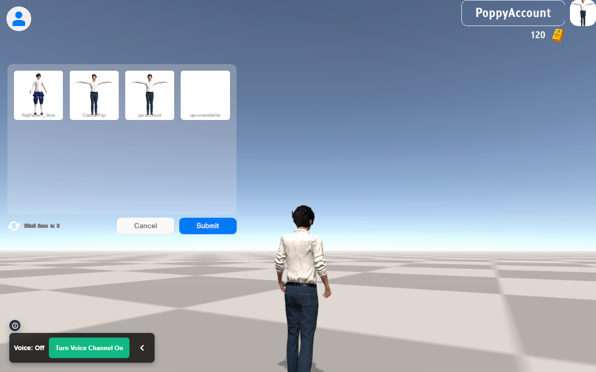
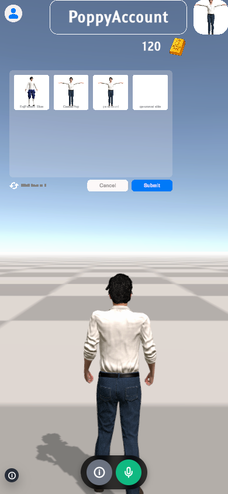

# MANGOs Framework validation results

[English](VALIDATION_EN.md) | [ภาษาไทย](VALIDATION.md) | [All documentation / เอกสารทั้งหมด](README.md)

Date: 16 October 2026 — Unity 6000.3.26f1

Baseline: `e461cdcad0b5bf7191f903afc828ea248b296a6f` / Unity 2022.3.62f3

The delivered default-profile build, `Builds/mangos/20261016-161442-6eaf09`, succeeded for Server and Client using 7770/WS and 443/WSS. Its manifest is preserved in [Validation/default-build-manifest.json](Validation/default-build-manifest.json). This output is ready for deployment configuration; it does not establish that a production service is running correctly.

## Completed checks

| Area | Result and evidence |
|---|---|
| Unity 6 / FishNet / glTFast / IL2CPP | Linux Dedicated Server IL2CPP and WebGL builds succeeded. Unity 6 was retained; the upgrade-skip condition was not needed. |
| Build Both | Job `20261016-160736-2dab27` completed both targets using the automatic runner that restarts Unity with the correct platform. Manifests were produced and generated resource configuration was restored. |
| Networking | The Linux Server ran in WSL. The matching compiled WebGL Client connected through FishNet at `ws://localhost:7788/validation/game` and entered BaseWorld as a guest. |
| Build settings | Checked default 7770/WS and 443/WSS, independent overrides, persistence, rejection of invalid paths/ports, and Server WSS certificate requirements. |
| Transport | Fixed case-insensitive `Sec-WebSocket-Key` header reading and checked the handshake with an actual WebGL connection. |
| Voice overlay | Mock tests passed for waiting for a room, join, mute, room changes retaining mute, leave, rapid room changes, changes during join, and dispose. The actual Client supplied Unity's world id to the overlay. |
| Controller | Edge/Chromium emulation passed for PC, iPhone, Android tablet, iPad desktop UA, and touchscreen PC. Checks covered simultaneous joystick/look/jump, rotation while holding input, focus/blur, keyboard Auto mode, automatic input switching, and cleanup after leaving. |
| Unity input | Checked movement/camera axes, one-shot jump/fly actions, sprint/vertical movement, and clearing input after orientation changes or text entry. |
| Humanoid | Built a separate Avatar per model. Tested two sizes, A-pose, reversed orientation, and 60 animation frames. Bones were animated and arm lengths remained constant; a model without a rig was rejected. |
| Real GLB example | MANGOs `RajPattern_Blue.glb`: identified and fixed crossed arms caused by treating the resting pose as a T-pose. Checked left/right hand positions after retargeting in Editor and standing/walking visuals in WebGL after HTTP 200 GLB loading. |
| VRM | A synthetic VRM 1.0 imported with its raw skeleton and valid Animator/Avatar in Editor. The UniVRM path is included in native builds. |
| .anim | Audited 52 Humanoid clips. No Transform position/scale curves directly stretching bones were found. A CSV export menu is available. |
| Shader / UI | Updated TextMeshPro shaders from Unity 6 Essential Resources while retaining GUIDs, fixing rectangular glyph rendering. Checked Launcher and world screenshots in portrait/landscape. |

The images under [Validation/](Validation/) come from the compiled Client. [browser-summary.json](Validation/browser-summary.json) records the build id and captured results. The guest name is **PoppyValidation**; desktop, portrait, and landscape screenshots were captured again using that name. It is a test identity, not a fixed production account or default player name.

## Not yet verified against real services/devices

- Physical iPhone/iPad/Android playtests have not run. All mobile emulation used Chromium, not Safari on a real device.
- Live voice with the user's accounts, physical microphones, production cookies/CORS, TURN, and network quality has not been tested.
- Checks cover one public GLB and a synthetic VRM 1.0, not every account avatar or real VRM 0.x/1.0 variant. Spring bones, cloth, extreme proportions, sitting, and interaction poses need additional real-model checks.
- GLB without a Humanoid skeleton, or with invalid skin weights/bind pose, cannot be guaranteed to use existing animations. Rig Profiles support mapping corrections and failures retain a fallback.
- The build pipeline was exercised through the batch runner. Editor GUI buttons and platform switching have not been clicked in an automated UI test.
- The live deployment and reverse proxy have not been changed. Publishing source through Git is separate from deployment/runtime verification.

## Remaining diagnostics

The original 16 October build logs include Mono/Cecil `Argument null or empty (name)` from ScriptUpdater even when BuildReport succeeded. Those historical logs are retained as evidence. The 17 October correction below removes the triggering legacy Rigidbody calls; the repeated builds have no ScriptUpdater or C# errors. Other warnings described here still apply.

The headless browser reports warnings for some internal shaders and software decompression of ASTC textures unsupported by its emulated GPU. Screenshots show the scene, sample GLB, and main text rendering, but real target GPUs/devices still need checks. Logs also include incomplete-audio-loading warnings and JobTempAlloc messages when Editor exits.

## Repeating the checks

- `Tools/BuildBoth.ps1 -Validation` runs Editor checks and builds the local 7788/WS pair.
- `MangosAvatarValidation.Run` checks synthetic Humanoid/VRM and the animation audit.
- `MangosRealAvatarValidation.Run -mangosAvatarFixture <path-to-glb>` checks a real Humanoid fixture without automatically downloading or bundling a model.
- The portable [WebGL integration script](../Tools/Validation/check-integration-webgl.cjs) uses **PoppyValidation** by default; see [Build and runtime](BUILD_AND_RUNTIME.md#repeat-the-webgl-screenshot-check).
- The original wider browser QA scripts and full logs are in the `validation` directory of the `html-voice-tester-main` workspace.

For this screenshot refresh, the Browser plugin/`browser` skill was not available, so the existing Playwright/Edge workflow was used. The flow was: local WebGL entry → start → guest login as PoppyValidation → BaseWorld → desktop/portrait/landscape capture. Voice used a mock service; this run does not extend the live-service claims above.

## Unity 6 API Updater correction — 17 October 2026

Opening the project reproduced ScriptUpdater exit 130 for FishNet.Runtime and Assembly-CSharp. Legacy `Rigidbody.velocity` / `Rigidbody2D.velocity` calls generated UnityUpgradable warnings, then Unity's updater failed while resolving replacement-member metadata through Mono.Cecil. This was an incomplete API migration, not a missing FishNet DLL.

Seven source files now use Unity 6's [Rigidbody.linearVelocity](https://docs.unity3d.com/6000.3/Documentation/ScriptReference/Rigidbody-linearVelocity.html) and [Rigidbody2D.linearVelocity](https://docs.unity3d.com/6000.3/Documentation/ScriptReference/Rigidbody2D-linearVelocity.html), including prediction state capture/restore and the walking/flying controller. FishNet serialized field names and packet order remain unchanged. CharacterController.velocity remains valid and was not changed. API Updater remains enabled; errors are not hidden or suppressed.

The stricter BuildReport check also caught three headless-build errors from TextMeshPro trying to open its resource importer. TMP Settings still used the old schema despite the earlier shader update. It has now been migrated from the installed Unity 6 TMP Essential Resources package to schema version 2, preserving all existing settings, font/sprite/style references, and asset GUID. The schema/default-font check runs with the physics checks. The repeated builds do not produce those importer-window errors.

Validation: Unity 6000.3.26f1 Editor compilation passed, followed by Linux IL2CPP Server and WebGL builds in job `20261016-172024-192144`, both with BuildReport errors=0 and no ScriptUpdater/C# errors. `MangosUnity6PhysicsValidation.Run` passed 3D/2D state capture, restore, angular-state preservation, and prediction velocity checks. It runs before `Tools/BuildBoth.ps1 -Validation` builds, and is also available at **MANGOs Framework > Validation > Unity 6 Physics**. The build-runner failure guard was checked against the original failing log and rejects it.

The test used an isolated project copy so the user's open Editor and existing project-setting edits were preserved. The default deployment profile remains 7770/WS and 443/WSS; these repeated builds use the local 7788/WS validation profile. This correction verifies compilation/builds and physics state, not a new live-voice or physical-mobile playtest. [Machine-readable evidence](Validation/unity6-api-updater-fix.json) records the build id, log hashes, and source hashes.

After updating an already-open Editor, use **Assets > Refresh** and allow compilation to finish. Clear old Console entries to inspect the new run; old entries from before the source update do not disappear automatically. A new project opening uses the corrected sources. Other deprecation/package/shader warnings may still appear; any new error needs investigation.

## Account avatars and automatic controller correction — 17 October 2026

Avatar selection previously waited for every model thumbnail; a slow/failed account model could keep the entire menu hidden. Choices are now available immediately, thumbnail work is limited to visible entries, failed previews keep a filename label, and opening the catalog resets its scroll position. The panel fits the screen safe area, pauses game input and hides touch controls while open. MANGOs API-origin binary model requests now use Cookie SSO credentials, while public external assets retain anonymous CORS.

The Controls selector and legacy toggle are removed. Old local overrides are cleared; desktop, phone, tablet, iPad desktop UA, orientation changes, and connected keyboard/mouse input select controls automatically. Desktop look comes from held-right-button browser pointer events. Canvas focus no longer cancels the first drag. Starter Assets yields camera target rotation to the browser controller, preventing its LateUpdate from overwriting touch/attached-mouse look.

The user-provided [CasualPop.glb](https://www.mangosgo.com/avatar/CasualPop.glb) passes the Editor Humanoid/60-frame animation check. Browser regressions use that public URL as the mock account's default and the same downloaded model as an API asset fixture. The account identity/API are mocked; these checks do not prove the user's production cookie or session. The source model is not bundled in Git.

Repeat with `Tools/Validation/check-controller.cjs` and `Tools/Validation/check-client-regressions.cjs`; see [Build and runtime](BUILD_AND_RUNTIME.md#account-and-controller-regressions). Machine-readable results and current screenshots are in [Validation/client-regressions.json](Validation/client-regressions.json). The failed intermediate QA runs are retained in the local workspace and are not release evidence. The test project uses a separate local 7788/WS profile and Cookie SSO override; the user's existing scene, auth asset and deployment settings remain untouched.

Final verification: build `20261017-023307-2194a9` succeeded for both targets with zero build/C#/ScriptUpdater errors. All four compiled cases passed: guest desktop, account desktop (including actual selection/Submit), account phone and account tablet. Touch camera rotation, automatic orientation changes, keyboard/mouse switching and RMB-only look passed on the mobile contexts. HTTP 401 for the guest and 404 for the unavailable thumbnail are intentional fixtures.

