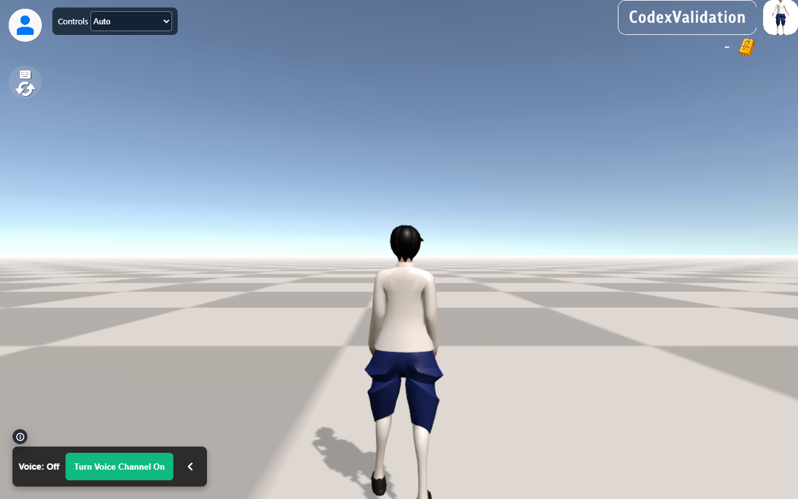

# MANGOs Framework

[ภาษาไทย](README_TH.md) | [English](README.md) | [เอกสารทั้งหมด / All documentation](Documentation/README.md)

Framework เกมหลายผู้เล่นสำหรับ **WebGL Client** และ **Linux Dedicated Server** ใช้ **Unity 6.3 LTS — 6000.3.26f1** และ **Universal Render Pipeline (URP)**

รุ่นปัจจุบันอยู่บน branch **`MANGOsFramework_U6`**

**[คู่มือใช้งาน](Documentation/HANDOFF_TH.md)** · [การ Build และ runtime](Documentation/BUILD_AND_RUNTIME_TH.md) · [ผลตรวจและข้อจำกัด](Documentation/VALIDATION.md)

## ความสามารถ

- FishNet multiplayer พร้อม Bayou/SimpleWeb WebSocket สำหรับ WebGL และ Tugboat สำหรับ native networking
- **Build Center** สร้าง Server, Client หรือทั้งคู่ แยก network profile และเลือก platform ให้อัตโนมัติ
- Browser voice overlay จาก `html-voice-tester` รวมใน WebGL template และผูกกับ world ปัจจุบัน
- โหลด GLB/VRM ขณะเล่นโดยใช้ Humanoid rig ของแต่ละโมเดล พร้อม calibrate T-pose ของ GLB และผูก animation/controller ใหม่
- เลือก keyboard/mouse หรือ touch สำหรับ PC โทรศัพท์/tablet และปรับเมื่อหมุนแนวตั้ง/แนวนอนระหว่างเล่น
- TextMeshPro shaders สำหรับ Unity 6 และเครื่องมือส่งออกรายงาน animation

## สิ่งที่ต้องติดตั้งและการเริ่มต้น

1. ติดตั้ง **Unity 6000.3.26f1** ผ่าน Unity Hub พร้อม **WebGL Build Support** และ **Linux Dedicated Server / IL2CPP build support** สำหรับ Server
2. ติดตั้ง Git และให้เรียกผ่าน `PATH` ได้ เพราะ Unity packages หลายตัวมาจาก Git
3. Clone branch นี้:

   ```bash
   git clone --branch MANGOsFramework_U6 https://github.com/AlbiziaLebbeck/MANGOFramwork.git
   ```

4. เพิ่มโฟลเดอร์ใน Unity Hub และเปิดด้วย **6000.3.26f1**
5. รอ Package Manager restore และ import ให้เสร็จ ให้ **Bootstrap** เป็น Scene แรกที่เปิดใช้งานสำหรับ Build

รุ่น packages และ Git revisions อยู่ใน [manifest.json](Packages/manifest.json) และ [packages-lock.json](Packages/packages-lock.json) เครื่องมือที่เก็บ source ในโปรเจกต์ เช่น FishNet, Starter Assets และ ParrelSync อยู่ใต้ `Assets/Plugins`

| Dependency | รุ่น / แหล่งที่มา | หน้าที่ |
|---|---|---|
| URP | 17.3.0 | Rendering |
| Input System | 1.20.0 | Input ผู้เล่น |
| Cinemachine | 2.10.7 | กล้อง |
| glTFast | 6.4.0 ตรึง Git revision | โหลด GLB/glTF ขณะเล่น |
| UniVRM / UniGLTF | 0.128.0 ตรึง Git tag | โหลด VRM |
| Linux SDK และ Windows-to-Linux toolchain | packages 1.1.0 | Build Linux IL2CPP จาก Windows |
| FishNet + Bayou / Tugboat | Source ในโปรเจกต์ | Multiplayer transport และ synchronization |

## Build Server และ Client

เปิด **MANGOs Framework > Build Center** แก้ **Client Path** แล้วเลือก **Build Server**, **Build Client** หรือ **Build Both** ระบบเลือก platform รวม browser overlay/controller และคืนค่า project settings ชั่วคราวเมื่อเสร็จ

ค่าของ Server และ Client แก้ได้แยกกัน:

| ค่า | Server เริ่มต้น | Client เริ่มต้น |
|---|---|---|
| Target | Linux Dedicated Server, IL2CPP, `.x86_64` | WebGL |
| Port | **7770** | **443** |
| WSS | **ปิด** | **เปิด** |

Client Host เริ่มต้นคือ `multiplayer-plus.mangosgo.com` และ Client Path คือ `/systemtester` ตาม deployment เดิม หากเว้น Host ว่างจะใช้ hostname ของหน้า WebGL **Client Path คือ path ของ WebSocket endpoint**

กด **Save Profile** เพื่อบันทึกใน [ProjectSettings/MangosBuildProfile.json](ProjectSettings/MangosBuildProfile.json) และ **Reset Network Defaults** เพื่อคืนค่าเครือข่ายโดยชัดแจ้ง การ Build ไม่ reset ค่าที่บันทึกเอง

แต่ละงานที่สำเร็จสร้าง:

```text
Builds/<deployment>/<build-id>/
  Server/
  Client/
  Deploy/
  build-manifest.json
```

`Builds/last-successful.json` ระบุ output ล่าสุดที่ครบ งานล้มเหลว/ยกเลิกไม่แทนที่ pointer นี้ Build outputs, local logs และ Unity caches สร้างในเครื่องและไม่เก็บใน Git

### Build Both ด้วย command line บน Windows

เรียกจาก project root:

```powershell
.\Tools\BuildBoth.ps1
```

ตัวเลือกเพิ่มเติม:

```powershell
.\Tools\BuildBoth.ps1 -Unity 'C:\path\to\Unity.exe' -Profile 'C:\path\to\profile.json'
```

ตัวสั่งงานเปิด Unity ใหม่ด้วย platform ที่ถูกต้องและทำงานเดิมต่ออัตโนมัติ log อยู่ใน `Builds/Logs` ดู batch entry points แยกใน [คู่มือ Build](Documentation/BUILD_AND_RUNTIME_TH.md)

## Deployment

ค่าเริ่มต้นใช้ reverse proxy รับ **WSS ที่ 443** แล้วส่ง WebSocket ต่อเข้า **WS Server ที่ 7770** ตัวอย่าง Nginx อยู่ใน `Deploy/` ต้องตั้ง hostname, certificate และ document root จริงก่อนใช้

- Deploy **โฟลเดอร์ Server ทั้งชุด** รวม `_Data`, `GameAssembly.so` และ `UnityPlayer.so` บน Linux เรียก `sh start-server.sh`
- ให้บริการ **โฟลเดอร์ Client ผ่าน HTTPS** พร้อม MIME type ของ JavaScript และ WebAssembly
- หากเปิด Server WSS ให้เตรียม PFX บน deployment host ใช้ `MANGOS_TLS_CERTIFICATE` แทน certificate path ได้ รหัสผ่านอ่านจาก environment variable ใน profile ซึ่งเริ่มต้นเป็น `MANGOS_TLS_PASSWORD`

ระบบไม่ฝัง certificate หรือรหัสผ่านลง WebGL เครื่องมือ Build สร้าง output และตัวอย่าง config ส่วนการนำไปใช้กับระบบจริงเป็นขั้นตอนแยก

## Browser voice และบริการบัญชี

WebGL template รวม `voice-app.js` และ `voice-overlay/` ให้อัตโนมัติ และถอด Unity `VoiceCommunication` เดิมแล้ว

Overlay รอให้เข้า world ก่อนอนุญาต join voice room key รวม deployment namespace กับ world id ของ Unity การเปลี่ยนโลก/disconnect ออกจาก media session เก่า ผู้เล่นต้องกดเข้าร่วมและอนุญาตไมโครโฟนด้วยตนเอง

Account API, voice/media backend, Socket.IO และ ICE/TURN ยังเป็นบริการภายนอก public endpoints อยู่ใน [voice-overlay/config.js](Assets/WebGLTemplates/MANGOsPWA/voice-overlay/config.js) Production ต้องรองรับ HTTPS, account cookies, credentialed CORS และ media/TURN ที่ใช้งานได้ ห้ามใส่ account tokens รหัสผ่าน certificate หรือ private credentials ในไฟล์ Build สาธารณะ

## Avatar และ animation

GLB ทั่วไปใช้ glTFast และสร้าง Humanoid Avatar จาก skeleton ของตนเอง Loader ปรับท่าพัก/A-pose เป็น T-pose และจัดแกนร่างกายก่อน retarget ส่วน VRM ใช้ UniVRM กับ Humanoid Avatar/raw skeleton ของโมเดลนั้น ระบบเดิน บิน FishNet animation และ interaction ผูกกับ Animator ปัจจุบัน

ค่าเริ่มต้นปรับความสูงภาพแบบ uniform เป็น **1.7 เมตร** ตาม collider เดิม ไม่ยืดความยาวกระดูก skin weights หรือ inverse bind matrices ให้ตรงตัวอ้างอิง

Humanoid GLB ที่ mapping ไม่ตรง สร้าง **Avatar Rig Profile** ผ่าน **Assets > Create > MANGOs Framework > Avatar Rig Profile** ใส่ให้ AvatarLoader หรือวางใต้ `Resources/AvatarRigProfiles` พร้อม URL prefix ที่ตรงกัน Rig ที่ไม่ผ่านจะคงโมเดลก่อนหน้า/default และรายงาน `LastLoadError`

การรองรับขึ้นกับ Humanoid skeleton และ skinning ที่ถูกต้อง ไม่สามารถใช้ Humanoid animations เดิมกับ GLB ทุกชนิดได้อัตโนมัติ การคงความสูงจริงต้องมีนโยบาย gameplay/collider ที่สอดคล้องกัน

ส่งออก `Library/MangosAnimationAudit.csv` ผ่าน **MANGOs Framework > Avatar > Export Animation Audit**

## Controller อัตโนมัติ

**Auto** เลือก keyboard/mouse บน PC และ touch บนโทรศัพท์/tablet รวม iPad desktop user agent ส่วน PC จอสัมผัสยังใช้ desktop mode ผู้เล่นเปลี่ยนเป็น **Touch** หรือ **Keyboard / mouse** เองได้

Touch มี joystick ซ้าย ลากกล้องด้านขวา Run และ Jump ส่วน Fly/Up/Down แสดงเฉพาะตัวละครที่บินได้ Layout ปรับตามแนวหน้าจอและ safe area การหมุนจอ เปลี่ยน input mode หลุด focus ยกเลิก pointer พิมพ์ใน HTML field และ disconnect ล้าง input ค้าง

Auto บน mobile เปลี่ยนเป็น keyboard/mouse เมื่อกดปุ่มเดินหรือใช้ mouse และกลับเป็น touch เมื่อแตะหน้าจอ

## ผลตรวจและข้อจำกัด

Build Linux IL2CPP และ WebGL สำเร็จ Client ที่ Build จริงเชื่อม Linux Server ใน WSL เข้า BaseWorld ด้วย guest และโหลด GLB สาธารณะได้ Browser tests ครอบคลุมห้า device configurations, input หลายนิ้ว การหมุนจอและ controller overrides ตรวจ Avatar หลายขนาด T/A-pose, GLB จริง และ synthetic VRM 1.0 แล้ว

ยังต้องเล่นบน iOS/Android จริง ตรวจ microphone/account/TURN สด และ VRM/ท่า Avatar จริงเพิ่มเติม ปุ่ม Editor แบบ GUI ยังไม่ได้คลิกใน automated UI test ส่วน build pipeline ผ่าน batch runner แล้ว

แก้จุดเรียก Rigidbody API เดิมที่กระตุ้น Unity 6 API Updater error โดยย้ายไปใช้ `linearVelocity` แล้ว ตัวสั่ง Build ปฏิเสธ ScriptUpdater ที่ล้มเหลว และ pipeline ปฏิเสธ BuildReport ที่มี error ดู [รายงานผลตรวจ](Documentation/VALIDATION.md) สำหรับผล Build ซ้ำ คำเตือนที่เหลือ และขอบเขตการทดสอบ

รัน Editor checks และ Build profile ทดสอบในเครื่องบน Windows:

```powershell
.\Tools\BuildBoth.ps1 -Validation
```

Profile นี้ใช้ **7788**, WS และ localhost แยกจาก deployment profile เริ่มต้น ภาพประกอบใช้ชื่อ guest **PoppyValidation** ดูวิธีถ่ายซ้ำใน [คู่มือ Build/runtime](Documentation/BUILD_AND_RUNTIME_TH.md)



## เอกสารและประวัติ migration

- [เอกสารภาษาไทยและภาษาอังกฤษทั้งหมด](Documentation/README.md)
- [คู่มือใช้งาน](Documentation/HANDOFF_TH.md)
- [การ Build และ runtime](Documentation/BUILD_AND_RUNTIME_TH.md)
- [ผลตรวจและข้อจำกัด](Documentation/VALIDATION.md)
- [แผน migration เดิม](Documentation/MIGRATION_PLAN_TH.md)

ฐาน Unity 2022 เดิมยังอยู่ใน Git history ที่ commit `e461cdcad0b5bf7191f903afc828ea248b296a6f`
